# Drought hindcast: which indicators match observed droughts?

SEAS5 seasonal forecasts, the Indian Ocean Dipole (IOD) and FEWS NET food-security projections against observed droughts in Ethiopia, Kenya, Zimbabwe and Lesotho, 1981 to 2026

Working version of 17 November 2026: long on purpose, to be trimmed. The definitions are not yet agreed.

---

<!-- _class: small -->

## In short

- **SEAS5 alerts have skill.** One month before the season, alerting when at least 40% of forecast members are dry (the 40% rule) catches 59% of droughts, and 45% of those alerts are false. Without skill that would be 36% and 66%.
- **FEWS NET is not a drought indicator: leave it out.** Before and during the season its alerts score as random alerts would. It shows a drought two to three months after the season.
- **IOD adds little on top of SEAS5.** Combining the two does no better than SEAS5 at another threshold. Only in Zimbabwe does it keep a role: there it scores like SEAS5 from October, and it alerts a month earlier for Jan–Mar.
- **On the 24 known cases of 2025–26, the rule catches 9 of the 11 reported droughts, where IBF v1 caught 4.** Those years flatter the rule: over all years it catches 59% of droughts, not 82%. Why v1 did worse is not explained yet.
- **The threshold is a trade-off without a sweet spot.** One month before, 30% catches 76% of droughts with 50% false alarms, 40% catches 59% with 45%, and 50% catches 33% with 31%.
- **The skill review holds up for SEAS5, and is on the careful side.** Of its 16 Include months, 14 pass its own bar here and 10 beat chance with the 40% rule. So do 14 of the 39 months it grades lower. Its Include months for FEWS NET do not hold up, and for the short rains IOD comes later than it expects.
- **How early an alert can be relied on differs by season.** JAS in northern Ethiopia from four months before; MAM, Kenya OND and Zimbabwe only at the season start; southern Ethiopia OND not at all at 40%.

---

## Sections

1. **Method and checks:** what is counted, how much data there is, and whether the numbers can be trusted.
2. **The known 2×2 matrix:** IBF v1 alerts against reported droughts in 2025–26, and how we get from there to the definition used here.
3. **From 24 cases to 46 years:** the same matrix on our drought definition and all years, then per lead time.
4. **Thresholds:** what a higher or lower threshold does.
5. **By region-season, against the skill review:** where the skill of SEAS5 sits, next to the grades from literature.
6. **Other indicators:** do FEWS NET and IOD add to SEAS5? FEWS NET drops out there, IOD stays only for Zimbabwe.
7. **Country deep dives:** Ethiopia, Kenya, Zimbabwe, Lesotho. From when an alert can be relied on, and what follows.
8. **Caveats and next steps.**

Not in this deck: ENSO, and thresholds fitted per region-season.

---

<!-- _class: divider -->
<!-- header: 1. Method and checks -->

# 1. Method and checks

What is counted, how much data there is, and whether the numbers can be trusted

---

<!-- _class: small -->

## What the charts show, and how it was checked

- **Cases:** 11 region-seasons in Ethiopia, Kenya, Zimbabwe and Lesotho, seasons from 1981 to 2026 (502 scored).
- **Alert:** at least 40% of the members of SEAS5 (ECMWF's seasonal forecast) put the region's season rainfall in the driest third of the hindcast.
- **Drought:** season rainfall in the driest third of years, from CHIRPS (rainfall from satellite and stations).
- **Hit rate:** share of droughts that got an alert. Higher is better.
- **False-alarm ratio:** share of alerts without a drought. Lower is better.
- **Level without skill:** what random alerts would score when issued as often as the real ones. For the hit rate that is the share of seasons with an alert, so it moves with the number of alerts.
- **Other indicators:** IOD and FEWS NET are scored on the same droughts with the same measures (section 6, method in the appendix).

Most charts show both measures against the months left until the season starts, with a 95% range.

- **Check, recalculated:** a second calculation from the raw files gives the same alert in 3,441 of 3,444 forecasts.
- **Check, split in two:** 1981–2003 and 2004–2026 both score above the level without skill at every lead time.

---

<!-- _class: chart -->

## Two alert rules: the region rule averages first, the area rule counts cells first

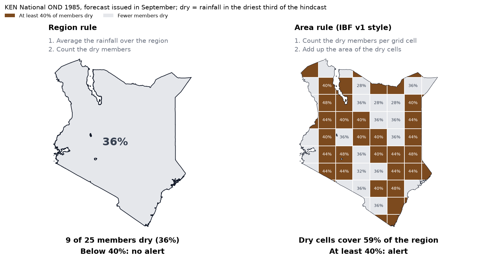

The area rule follows IBF v1. The region rule is a proposal of this analysis, still to be confirmed. One month ahead they agree on 93% of forecasts (469 of 506) and score alike over all years: 59% hits and 45% false alarms for the region rule, 62% and 45% for the area rule.

---

<!-- _class: chart -->

## Behind every score: 172 droughts in 502 seasons

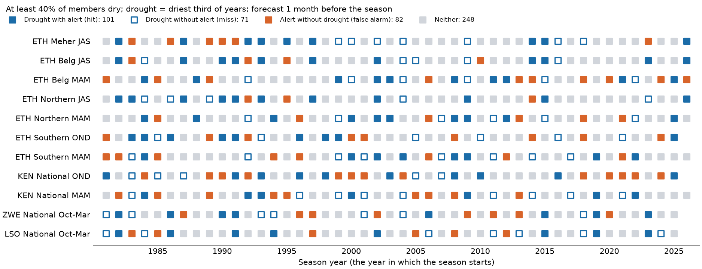

Droughts bunch in years: 8 of 11 region-seasons in 1984, none in 2020. They therefore count as about 90 independent droughts, and each region-season has only 15 or 16.

---

<!-- _class: divider -->
<!-- header: 2. The known 2×2 matrix -->

# 2. The known 2×2 matrix

IBF v1 alerts against reported droughts in 2025–26, and how we get from there to the definition used in the rest of this deck

---

## The starting point: IBF v1 caught 4 of 11 reported droughts

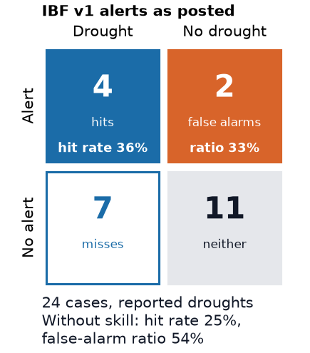

- **Source:** the workbook Drought_events_vs_IBF_alerts_ETH_KEN_LSO, sheet Matrix.
- **Cases:** 7 areas in Ethiopia, Kenya and Lesotho, seasons from MAM 2025 to JAS 2026. 24 are counted.
- **Alert:** an alert that IBF v1 posted for that area and season, at any date.
- **Drought:** a drought reported for that area and season, from the sources in the workbook.
- **Counting:** by hand. A partial hit counts as a hit; "mostly false alarm" as a false alarm.

---

<!-- _class: chart -->

## Our closest version of that matrix looks very different

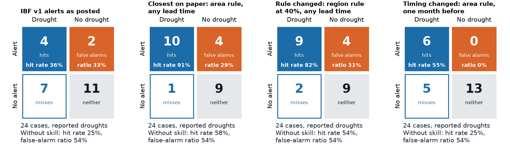

IBF v1 used the area rule, and its alerts count at any date. The second matrix is our calculation with those two choices. The third and fourth each change one of them. Our forecasts are matched to the 24 cases by hand (appendix).

---

## Exact replication is not needed to continue, but one check stays open

- **Our closest version does not reproduce IBF v1.** It gives the same alert or no alert in 14 of the 24 cases. Always saying "no alert" would agree in 18.
- **The earlier matrix is not one fixed rule.** Three of its six alerts were posted during the season. For Northern MAM 2026, alerts in December and January were withdrawn and count as no alert.
- **So the gap lies in v1's calculation, not in rule or timing.** Candidates: a dry threshold taken from the wrong start month (suspected flaw), rolling three-month totals, its own areas, and 1991–2020 as reference.
- **Not needed to continue:** this analysis tests the proposed logic, not v1.
- **Still open:** is v1's threshold wrong? The stored v1 output for 2025–26 would answer that without a rerun.

---

## From here on, the alert uses the region rule

- **The two rules score alike.** Over all years, one month before: 59% hits and 45% false alarms for the region rule, 62% and 45% for the area rule. So the choice rests on simplicity, not on skill.
- **Same quantity as the drought.** The drought is defined on the region's average season rainfall, and so is the region rule.
- **One threshold to explain and to tune,** instead of two.
- **Checked.** The second calculation from the raw files covers the region rule, not the area rule.

The area rule is what IBF v1 runs. If NRW is to carry over v1's logic unchanged, this choice needs revisiting.

---

## Alerts are scored per lead time, not "at any lead time"

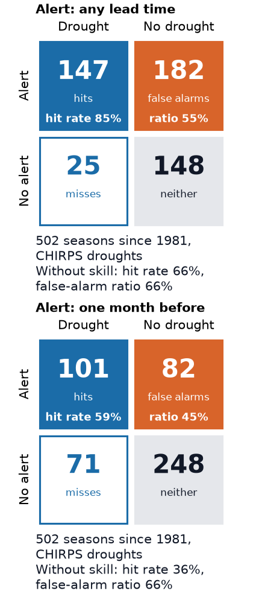

- **Five forecasts give five chances to alert.** Counted at any lead time, two of three seasons get an alert.
- **That inflates the hit rate.** 85% of droughts are caught, but random alerts as frequent as these would catch 66%.
- **More than half of those alerts are false:** 55%, against 66% without skill.
- **One forecast at a time is stricter and more useful.** One month before, 59% of droughts are caught (36% without skill) and 45% of alerts are false. It also answers the practical question: how far to trust an alert issued in a given month.

---

## The definition this deck continues with

- **Alert:** region rule. At least 40% of members forecast the region's season rainfall in the driest third of the hindcast. Section 4 looks at the threshold.
- **Scoring:** per lead time, from 4 to 0 months before the season. One month before is the headline number.
- **Drought:** CHIRPS season rainfall of the region in the driest third of years.
- **Status:** still to be confirmed.

On the 24 cases this gives 9 hits, 2 false alarms, 2 misses and 11 neither. That is a spot check, not a score:

- With 11 droughts, 9 of 11 could be anything from 48% to 98%, and v1's 4 of 11 anything from 11% to 69%.
- Four of the forecasts sit at exactly 21 of 51 members. They give 4 of the 9 hits and both false alarms.

---

<!-- _class: divider -->
<!-- header: 3. From 24 cases to 46 years -->

# 3. From 24 cases to 46 years

The same matrix on our drought definition and all years, then per lead time

---

<!-- _class: chart -->

## Over all years the rule scores clearly lower than in 2025–26

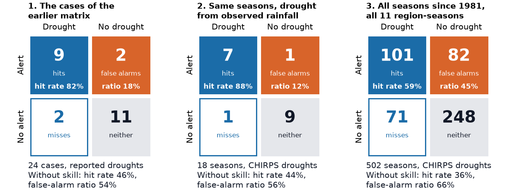

The same alert definition in every step: region rule at 40%, one month before the season. Step 2 changes the drought to observed rainfall, step 3 adds all years. In 2025–26 the rule caught 82 to 88% of droughts with 12 to 18% false alarms; over all years that is 59% and 45%.

---

## Per lead time: alerts beat chance throughout, and improve towards the season

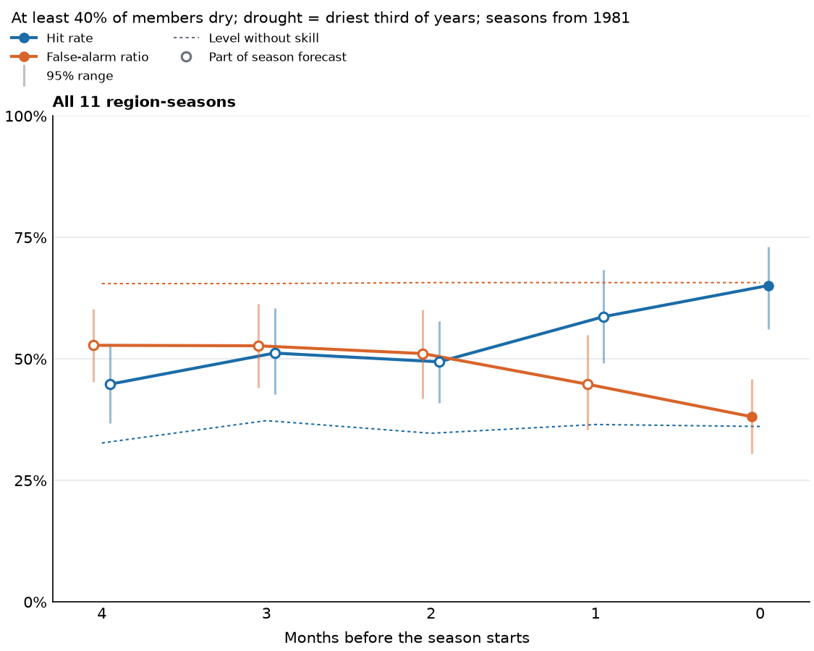

- Hit rate rises from 45% at 4 months to 65% at season start.
- False-alarm ratio falls from 53% to 38%.
- Without skill these would sit near 35% and 66%.
- From 4 to 1 months ahead, some forecasts cover only part of the season.

---

<!-- _class: divider -->
<!-- header: 4. Thresholds -->

# 4. Thresholds

What a higher or lower threshold does

---

<!-- _class: chart -->

## A higher threshold trades hits for fewer false alarms

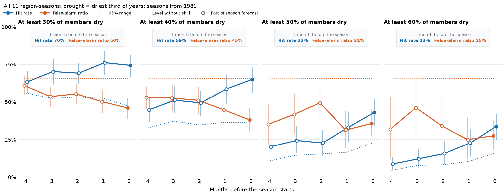

The region rule at four thresholds. One month before, 52% of seasons get an alert at 30%, 36% at 40%, 17% at 50% and 10% at 60%.

---

<!-- _class: chart small -->

## Lowering the threshold to 30% adds alerts that are close to random

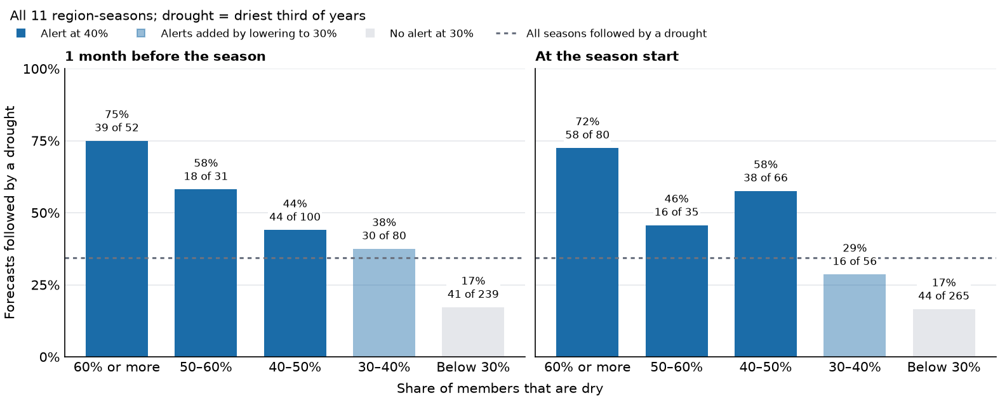

- **How to read it:** every forecast is in one bar. The bar shows how often a drought followed; the dashed line is any season.
- **From 40% to 30%:** 80 more alerts one month before, 30 of them droughts. That is 38%, against 34% for any season.
- **Why the overall numbers hide this:** averaged with the 183 stronger alerts, the false-alarm ratio only goes from 45 to 50%.
- **By region-season:** at 30% the alerts beat chance in 22 of 55 combinations of region-season and lead time, at 40% in 24.

---

## A stricter drought definition raises both measures

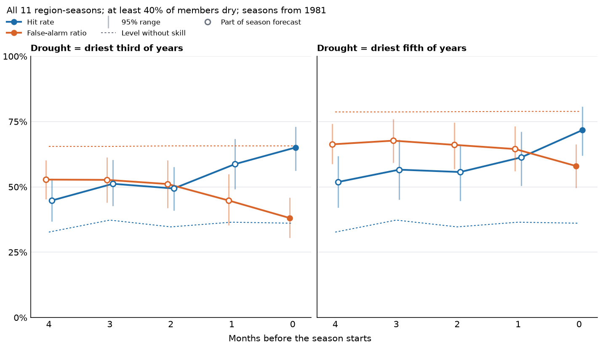

- Driest fifth, one month ahead: 61% hits, against 59% for the driest third.
- False-alarm ratio is 64%, against 45%.
- Droughts are rarer (21% of seasons) while the alerts stay the same; without skill the ratio would be 79%.

---

<!-- _class: small -->

## Recommendation: keep one threshold for now, and choose it on cost

- **Do not fit a threshold per region-season yet.** Each has 15 or 16 droughts, so one drought moves its hit rate by 6 points. A fitted threshold would mostly fit noise, and would first need a test on years left out.
- **There is no sweet spot.** Every step down costs more false alarms per extra drought caught: 0.7 from 60% to 50%, 1.3 from 50% to 40%, and 1.7 from 40% to 30%. The choice is about which error costs more, a missed drought or a false alarm. That is a decision, not a statistic.
- **What each threshold gives, one month before:**
  - 30% catches three of four droughts, but alerts in half of all seasons, and half of those alerts are false. Against 40% it catches 30 more droughts for 50 more false alarms.
  - 40% catches 59%, with 45% false.
  - 50% and 60% catch a third or less.
- **A yardstick from practice, not like for like:** WFP's drought system in Mozambique asks for at least 55% of droughts caught and under 35% of actions in vain. It counts more severe droughts, counts false alarms more leniently, and tunes its triggers per district. On our stricter counting, 40% at the season start comes closest: 65% and 38%.
- **Worth discussing:** two levels, an early notice at 40% and action at a higher threshold or a later forecast.

---

<!-- _class: divider -->
<!-- header: 5. By region-season, against the skill review -->

# 5. By region-season, against the skill review

Where the skill sits, next to the grades from literature (NRW_drought_indicator_skill_IFRC_Africa)

---

<!-- _class: chart -->

## By region-season the samples get small: read patterns, not single values

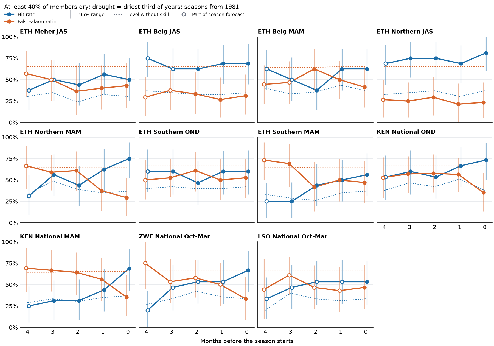

Each region-season has 15 or 16 droughts, so one drought moves its hit rate by 6 points. Two patterns repeat: Northern JAS and Belg JAS beat chance at every lead time, and the MAM seasons do so reliably only in the last month or at the season start.

---

<!-- _class: chart small -->

## Our alerts follow the review's pattern, except for the short rains

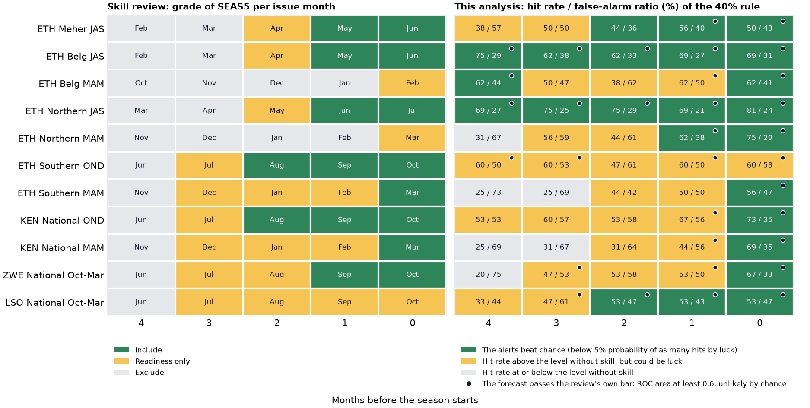

**Right:** hit rate / false-alarm ratio of the 40% rule; green where the alerts beat chance. **Dot:** the forecast passes the review's own bar, a ROC area of at least 0.6. That is how often a drought year had more dry members than another year, whatever the threshold (0.5 is a coin flip). Yellow with a dot: the forecast tells drought years apart, but the 40% rule does not use it.

---

<!-- _class: small -->

## The review is on the careful side; for the short rains the 40% rule falls short

| Grade in the review | Months | Alerts beat chance | Above no skill, could be luck | At or below no skill | Forecast passes the review's bar |
| ------------------- | ------ | ------------------ | ----------------------------- | -------------------- | -------------------------------- |
| Include             | 16     | 10                 | 6                             | 0                    | 14                               |
| Readiness only      | 19     | 8                  | 9                             | 2                    | 11                               |
| Exclude             | 20     | 6                  | 10                            | 4                    | 8                                |
| **Total**           | **55** | **24**             | **25**                        | **6**                | **33**                           |

- **Two questions:** the first three columns ask whether the 40% rule gives alerts that beat chance. The last asks whether the forecast tells drought years apart at any threshold, which is how the review graded.
- **Confirmed:** the JAS seasons from May or June, and MAM at the season start, pass on both.
- **Higher here:** Belg JAS and Northern JAS pass on both from February and March, and Lesotho from August, where the review had no verification to go on.
- **Short rains:** for southern Ethiopia and Kenya OND the forecast passes the review's bar from September. But before the season starts, half or more of the 40% rule's alerts are false. It beats chance only for Kenya in October.

---

## What to take from the region-season view

- **Keep the review's Include months.** 14 of 16 pass its own bar here, and the other two are just short. With the 40% rule, 10 of 16 beat chance; the six that do not are five short-rains months and Zimbabwe in September.
- **Three candidates for an upgrade, to discuss:** Belg JAS from February, Northern JAS from March, and Lesotho from August. On the review's own measure nothing needs a downgrade.
- **Short rains:** the forecast tells drought years apart, but 40% gives too many false alarms. That is a threshold question, not a reason to distrust SEAS5.
- **Do not act on single cells.** Each rests on 15 or 16 droughts. Only patterns that repeat count.
- **Scope:** SEAS5 only, and one rainfall source. Section 6 does the same for IOD and FEWS NET. ENSO is not measured.

Where the review quotes a number, ours is in the same range: for Kiremt, the May forecast correlates 0.68 with observed rainfall there and 0.57 here.

---

<!-- _class: divider -->
<!-- header: 6. Other indicators: FEWS NET and IOD -->

# 6. Other indicators: FEWS NET and IOD

Do they add to SEAS5? FEWS NET does not, and drops out here. IOD does only in Zimbabwe, which the deep dive takes up.

---

<!-- _class: small -->

## FEWS NET: leave it out as a drought indicator

- **What was scored:** the share of a region's area that FEWS NET projects in Phase 3 (Crisis) or worse for the season. Alert: that share is in the upper third for that region and month. On 10 region-seasons from 2011 to 2026, with 40 droughts.
- **Before the season, no skill.** One month before, the alert catches 14 of 40 droughts with 74% false alarms. That is what random alerts would score. SEAS5 on the same seasons catches 23 of 40 with 52%.
- **Not within the season either.** FEWS NET shows a drought two to three months after the season, when the area in Phase 3 or worse is 17 to 18 points above usual.
- **The skill review grades FEWS NET Include in the months up to the season end.** That grade rests on its publication calendar, not on measured skill. None of those 50 months beats chance here.
- **What follows:** FEWS NET raises no alert, alone or next to SEAS5, and the review's Include grade for it is not carried over. It does not return in the country deep dives.
- **Limits:** tested in Ethiopia, Kenya and Zimbabwe only, on 15 years with one to six droughts per region-season.

---

<!-- _class: chart -->

## Before the season, FEWS NET alerts score as random alerts would

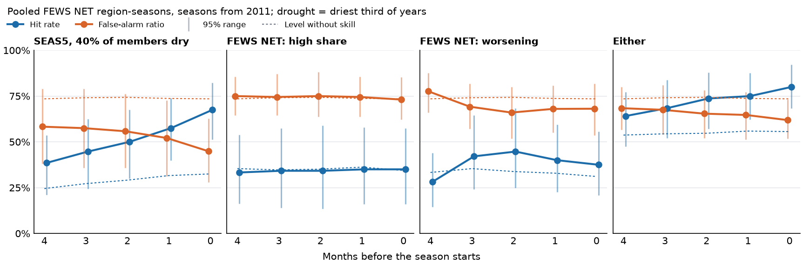

One month before: FEWS NET catches 14 of 40 droughts with 74% false alarms, projected worsening 16 of 40 with 68%, SEAS5 23 of 40 with 52%. In none of the 60 combinations of region-season and lead time do FEWS NET alerts beat chance; SEAS5 does in 13. Alerting on either adds 37 alerts and 7 hits to SEAS5.

---

<!-- _class: chart small -->

## FEWS NET shows a drought two to three months after the season, not before

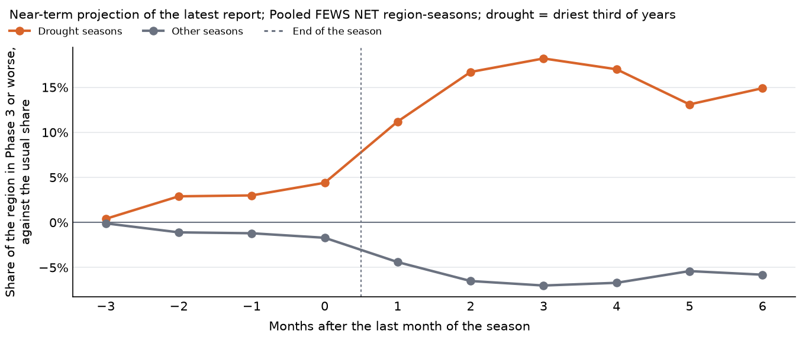

- **Timing:** in the last months of a drought season the area in Phase 3 or worse is at most 4 points above its usual level. One month after it is 11 points above, two to three months after 17 to 18 points. After other seasons it is 4 to 7 points below.
- **Zimbabwe 2023–24:** before that drought FEWS NET projected 29%, below its usual level. Afterwards the area rose to 100%, and the alert came for 2024–25, which was not dry.

---

<!-- _class: chart small -->

## Where the review grades FEWS NET Include, we measure no skill against rainfall

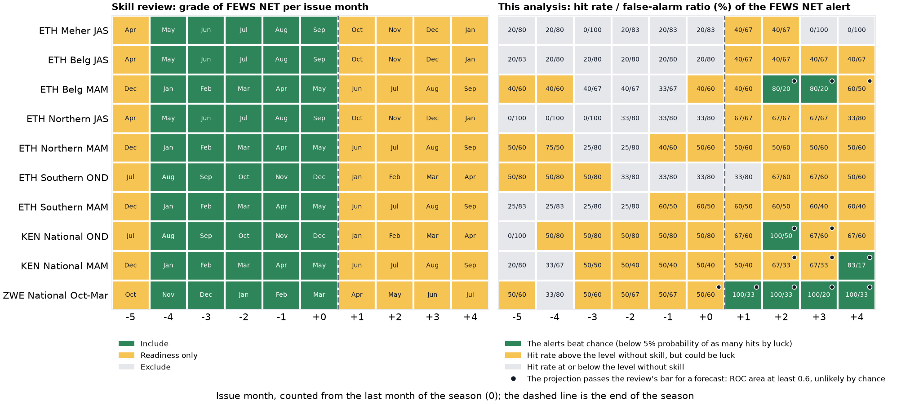

**Left:** the review grades a month Include when that month's projection reaches the months in which the impact shows. That follows from the publication calendar, not from measured skill. **Right:** the alert on that projection, scored on rainfall droughts. Up to the season end none of the 50 Include months beats chance: the alert catches 30 to 41% of droughts while it is on in 35% of seasons. After the season 8 of 40 months do. Each cell rests on one to six droughts.

---

<!-- _class: small -->

## IOD: adds little on top of SEAS5, and stays only for Zimbabwe

- **What was scored:** the Indian Ocean Dipole index of the month before the forecast: observed, not forecast. Alert: the index is in the outer third of its own values. A negative index goes with drought in the short rains (OND) of southern Ethiopia and Kenya, a positive index with drought in Zimbabwe.
- **Combining it with SEAS5 does not beat moving the SEAS5 threshold.** One month before, an alert when either alerts catches 74% of droughts with 58% false alarms. SEAS5 alone at 30% catches 84% with 53%, for as many alerts.
- **The two largely see the same thing.** SEAS5 starts from the observed ocean, so the IOD is already in the forecast. IOD catches 6 of the 17 droughts that SEAS5 misses, and adds 15 false alarms.
- **Short rains:** no earlier alert. Before the season the IOD alert does not beat chance in southern Ethiopia or in Kenya.
- **Zimbabwe:** IOD scores like SEAS5 from October, and alerts a month earlier for Jan–Mar. It is the pre-season trigger of Zimbabwe's drought Early Action Protocol.
- **What follows:** no IOD condition next to SEAS5. Outside Zimbabwe, IOD does not return in the country deep dives.

---

<!-- _class: chart small -->

## Either or both: SEAS5 alone at another threshold does as well or better

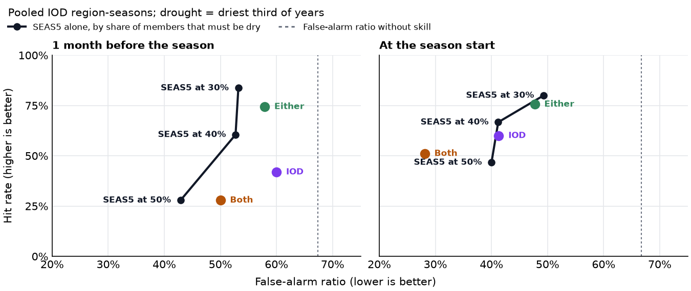

- **How to read it:** up is more droughts caught, left is fewer false alarms. One month before, every alert that uses IOD has a SEAS5-only alert above it or to its left.
- **Either** catches 74% of droughts with 58% false alarms. SEAS5 alone at 30% catches 84% with 53%, for as many alerts. **Both** is ahead only at the season start.
- **Every indicator that has skill must alert:** 40% with 53%. That loses a third of SEAS5's hits and no false alarms.

---

<!-- _class: small -->

## Short rains: IOD does not come earlier than SEAS5

- **The gap:** with the 40% rule, SEAS5 alerts are reliable only in October for Kenya OND, and never for southern Ethiopia OND (section 7).
- **Before the season, IOD alerts do not beat chance either.** In August and September they catch 5 to 7 of 14 or 15 droughts, with 53 to 67% false alarms.
- **October, southern Ethiopia:** the IOD alert beats chance, with 10 of 15 droughts and 38% false alarms, against 9 of 15 with 53% for SEAS5. In Kenya SEAS5 is ahead: 11 of 15 with 35%, against 9 of 15 with 44%.
- **Not taken further:** that is one month in one region-season, at the season start.
- **The review expects more.** It grades IOD Include from July and SEAS5 from August. Its July to September grades rest on a forecast of the index. Here it is last month's observed index, and in July that says little about the autumn peak.
- **Not tested:** a forecast of the IOD. If an earlier signal for the short rains exists, that is where it would come from.

---

<!-- _class: divider -->
<!-- header: 7. Country deep dives -->

# 7. Country deep dives

Ethiopia, Kenya, Zimbabwe, Lesotho: from when an alert can be relied on, and what follows. SEAS5 throughout, and IOD for Zimbabwe.

"Reliable from" means: the 40% rule beats chance at that forecast and at every later one.

---

<!-- header: 7. Country deep dives: Ethiopia -->

## Ethiopia: the JAS seasons carry the skill, MAM comes late

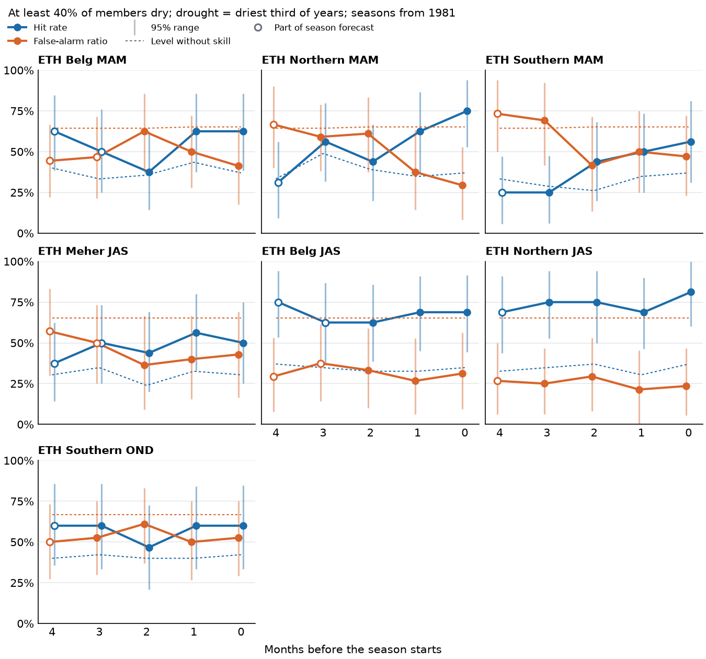

- **MAM (top row):** alerts beat chance only one month before the season (Northern) or at its start (Belg, Southern).
- **JAS (middle row):** Northern and Belg beat chance from four months before. Meher follows from two months before.
- **OND (bottom):** Southern never beats chance at 40%. About half of its alerts are false at every lead time.

---

<!-- _class: chart -->

## Ethiopia: 2015 and 2026 were caught, the Meher droughts of 1999–2009 were not

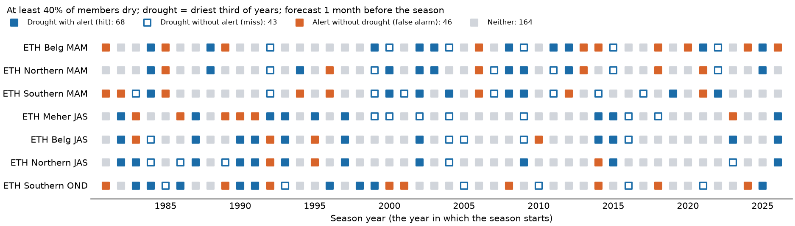

The El Niño year 2015 is a hit in all three JAS seasons, as is 2026. Meher JAS missed five droughts running between 1999 and 2009, among them 2002 and 2009, the third and fourth driest.

---

<!-- _class: small -->

## Ethiopia: what follows

| Region-season | Alerts reliable from          | Hit rate / false-alarm ratio then |
| ------------- | ----------------------------- | --------------------------------- |
| Northern JAS  | March, 4 months before        | 69% / 27%                         |
| Belg JAS      | February, 4 months before     | 75% / 29%                         |
| Meher JAS     | April, 2 months before        | 44% / 36%                         |
| Northern MAM  | February, 1 month before      | 62% / 38%                         |
| Belg MAM      | February, at the season start | 62% / 41%                         |
| Southern MAM  | March, at the season start    | 56% / 47%                         |
| Southern OND  | never at 40%                  | 60% / 53% at the season start     |

- **JAS:** alerts can be acted on early, from February or March in the north and the Belg area.
- **MAM:** an alert is only reliable when the season is about to start. Whether that is still useful is a decision.
- **Southern OND:** test a higher threshold together with Kenya OND. IOD gives no earlier alert there (section 6).
- **No region-season is dropped and no threshold is fitted:** each has 15 or 16 droughts.

---

<!-- header: 7. Country deep dives: Kenya -->

## Kenya: reliable only at the season start

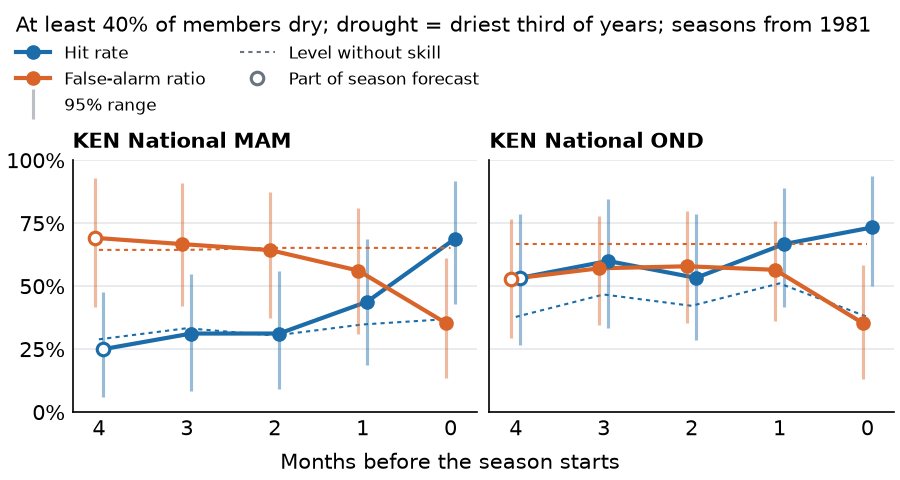

- **MAM:** alerts beat chance only in March, with 69% hits and 35% false alarms. Before that they are no better than chance.
- **OND:** alerts beat chance only in October: 73% and 35%. In September 67% of droughts are caught, but 56% of alerts are false.
- **The information is there for OND:** forecast and observed rainfall move together (correlation 0.81), and the forecast passes the review's bar from September.

---

<!-- _class: chart -->

## Kenya: the alerts of OND 2020 to 2022 count as false alarms

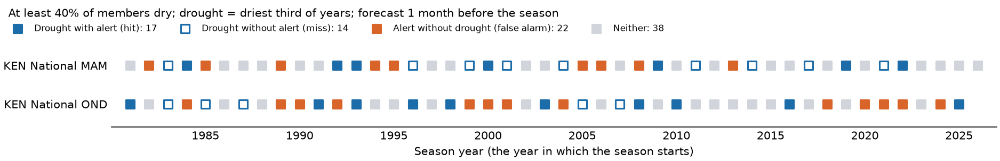

OND 2020, 2021 and 2022 had an alert one month before. National rainfall ranks 29, 25 and 16 of 45, so none is in the driest third (ranks 1 to 15). These are years known as the 2020–22 Horn drought, so the next slide checks the region.

---

<!-- _class: small -->

## Kenya: scoring on the arid and semi-arid counties changes one season

| OND season | Whole country | 23 arid and semi-arid counties | 9 arid counties |
| ---------- | ------------- | ------------------------------ | --------------- |
| 2020       | 29            | 28                             | 28              |
| 2021       | 25            | 26                             | 21              |
| 2022       | 16            | **10**                         | **8**           |
| 2025       | **9**         | **9**                          | **9**           |

Rank of the season rainfall among 45 seasons, from the driest. Bold: in the driest third (ranks 1 to 15).

- **Why look:** the skill review and the earlier matrix are about the arid and semi-arid counties; our Kenya is the whole country.
- **Nearly the same region:** those 23 counties are 89% of the country, and 14 of the 15 OND droughts are the same seasons.
- **Only 2022 changes.** By CHIRPS, the drought of those years sits in MAM 2021 (rank 14 of 46), MAM 2022 (rank 6) and OND 2022.
- **FEWS NET** shows a clear rise in food insecurity after OND 2020 and after OND 2021. That fits the reports, but the six months after those seasons include the dry MAM seasons.
- **Next check:** a second rainfall source, or a smaller area such as the north-east. Not a different outcome. This is CHIRPS only: SEAS5 is not rerun on these counties.

---

<!-- _class: small -->

## Kenya: what follows

| Season | Alerts reliable from         | Hit rate / false-alarm ratio then |
| ------ | ---------------------------- | --------------------------------- |
| MAM    | March, at the season start   | 69% / 35%                         |
| OND    | October, at the season start | 73% / 35%                         |

- **Both seasons:** with the 40% rule an alert is reliable only at the season start. Whether that is still useful is a decision.
- **OND is the candidate for a higher threshold.** At the season start, 60% gives 45% hits with 18% false alarms. To be tested on years left out, together with southern Ethiopia OND.
- **MAM months ahead:** the forecast itself is weak there, so no threshold will help.
- **Open:** OND 2020 and 2021. The region does not explain them; a second rainfall source is the next check.

---

<!-- _class: small -->
<!-- header: 7. Country deep dives: Zimbabwe and Lesotho -->

## Zimbabwe and Lesotho: which season is scored matters

Both are scored on the whole rainy season (Oct–Mar) and on its two halves (OND and JFM). Only Oct–Mar counts in the pooled results.

- **It changes what counts as a drought.** A whole-season drought is mostly a second-half drought. In Zimbabwe 13 of the 15 Oct–Mar droughts are also JFM droughts, and 9 are also OND droughts; in Lesotho 11 and 10. In 2023–24 Zimbabwe's OND was not dry (rank 19 of 45), while JFM was the second driest of 46.
- **It decides how early the whole season can be forecast.** SEAS5 reaches six months, so Oct–Mar is fully covered only by the October forecast. JFM is also fully covered from October, which is three months before it starts.
- **It decides whether forecasts within the season are needed.** With one long season, a January forecast must be combined with the rain that already fell. With two halves, the same forecast is an ordinary pre-season forecast for JFM.
- **Predictability and impact differ within the season.** The literature in the skill review puts the ENSO signal in mid to late summer. The early rains matter for planting, January and February for the maize harvest (general knowledge, not checked here).

---

<!-- _class: chart -->
<!-- header: 7. Country deep dives: Zimbabwe -->

## Zimbabwe: October for the whole season, November for its second half

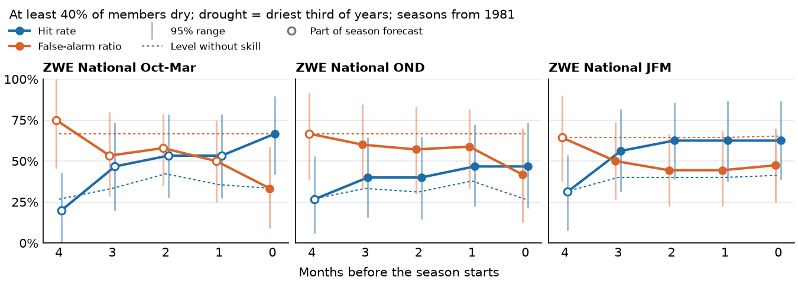

Oct–Mar and OND beat chance only with the October forecast: 67% hits and 33% false alarms, and 47% and 42%. JFM beats chance from November, two months before it starts, with 62% and 44%.

---

<!-- _class: chart -->

## Zimbabwe: the droughts of 2015–16 and 2023–24 were alerted

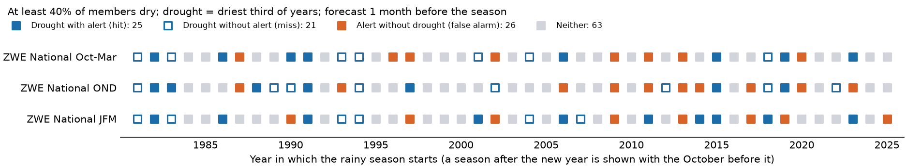

2023–24 was the second driest Oct–Mar of 45, and the drought sat in JFM. The Oct–Mar forecasts alerted from August, the JFM forecasts from September. 2015–16 was alerted from July.

---

<!-- _class: small dense -->

## Zimbabwe: IOD scores like SEAS5 from October, and a month earlier for Jan–Mar

| Forecast month | SEAS5 for Oct–Mar       | SEAS5 for Jan–Mar       | IOD for Jan–Mar, last month's index | IOD for Jan–Mar, last four months |
| -------------- | ----------------------- | ----------------------- | ----------------------------------- | --------------------------------- |
| September      | 8 of 14, 50% false      | 5 of 15, 64% false      | 8 of 15, 47% false                  | 8 of 15, 47% false                |
| October        | **10 of 15, 33% false** | 9 of 16, 50% false      | **9 of 16, 36% false**              | **8 of 15, 43% false**            |
| November       |                         | **10 of 16, 44% false** | 8 of 16, 47% false                  | **9 of 15, 40% false**            |
| December       |                         | **10 of 16, 44% false** | **10 of 16, 33% false**             | **9 of 15, 40% false**            |
| January        |                         | **10 of 16, 47% false** | 5 of 16, 67% false                  | **10 of 16, 33% false**           |

Droughts caught, and the share of alerts that were false. Bold: the alerts beat chance.

- **Whole season:** IOD adds nothing to the October SEAS5 alert: alerting on either adds three false alarms and no hit. In September no alert beats chance.
- **Jan–Mar,** which holds 13 of the 15 whole-season droughts: the IOD alert beats chance in October, the SEAS5 alert from November. Averaged over four months, IOD does so at every forecast from October.
- **In line with the trigger in use:** Zimbabwe's drought Early Action Protocol uses the observed index as its pre-season trigger. The skill review quotes its technical annex at 70% of droughts caught and 42% false alarms for the June to September index, on 2000 to 2024 and another drought measure. Here: 53% and 43% on the 44 seasons up to 2026.
- **Limits:** 15 or 16 droughts, and the review grades IOD for Zimbabwe Readiness only.

---

<!-- _class: small -->

## Zimbabwe: what follows

| Season  | Alerts reliable from         | Hit rate / false-alarm ratio then |
| ------- | ---------------------------- | --------------------------------- |
| Oct–Mar | October, at the season start | 67% / 33%                         |
| OND     | October, at the season start | 47% / 42%                         |
| JFM     | November, 2 months before    | 62% / 44%                         |

- **Keep Oct–Mar as the season,** with the October forecast as the one to act on. No definition clearly beats it.
- **JFM is a candidate for a second alert moment.** Most droughts sit in JFM, and the November and December forecasts for it beat chance. That would replace special logic for forecasts within the season.
- **Before October nothing is reliable with the 40% rule.** The review grades September as Include; the forecast passes its bar then, the rule does not.
- **IOD:** a candidate second indicator from October, as in Zimbabwe's drought Early Action Protocol. It brings no reliable alert before October. If JFM becomes an alert moment, IOD gives that alert in October, a month before SEAS5.
- **No threshold is fitted:** 15 droughts are too few.

---

<!-- _class: chart -->
<!-- header: 7. Country deep dives: Lesotho -->

## Lesotho: modest skill from August, and no gain at the season start

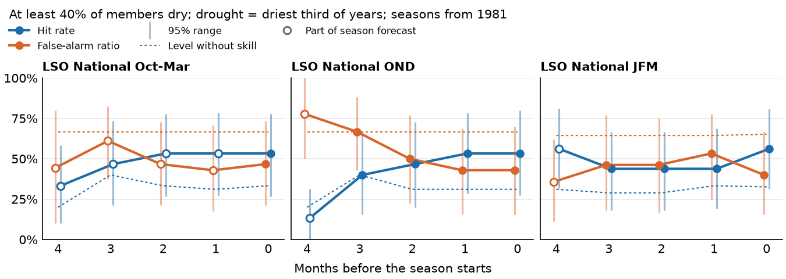

Oct–Mar: 53% hits from August to October, with 43 to 47% false alarms. OND beats chance from September with 53% and 43%. JFM beats chance only in January, with 56% and 40%.

---

<!-- _class: chart -->

## Lesotho 2024–25: dry in CHIRPS, no alert, and no drought reported

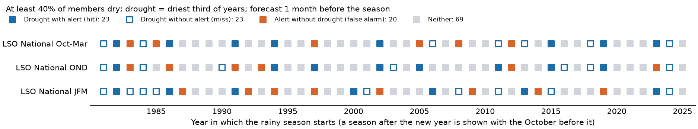

2024–25 ranks 5th driest of 45 in CHIRPS, and both halves were dry (OND rank 9 of 45, JFM rank 10 of 46). No forecast came near 40% of members. The earlier matrix records no drought for that season. Worth checking against a second rainfall source.

---

<!-- _class: small -->

## Lesotho: what follows

| Season  | Alerts reliable from         | Hit rate / false-alarm ratio then |
| ------- | ---------------------------- | --------------------------------- |
| Oct–Mar | August, 2 months before      | 53% / 47%                         |
| OND     | September, 1 month before    | 53% / 43%                         |
| JFM     | January, at the season start | 56% / 40%                         |

- **A first measurement, and a thin one.** The review had no verification for Lesotho and grades it Readiness only. Here the alerts beat chance from August, but only just, and they catch about half of the droughts.
- **Candidate for an upgrade from August,** to discuss. Lesotho is about average among the region-seasons, not strong.
- **2024–25 was missed entirely.** Check it against a second rainfall source before relying on either.
- **Keep Oct–Mar as the season.** No threshold is fitted: 15 droughts are too few.

---

<!-- _class: small dense -->
<!-- header: 7. Country deep dives: overview -->

## From when can an alert be relied on? Three decisions follow

| Region-season    | Alerts reliable from | Hit rate / false-alarm ratio then |
| ---------------- | -------------------- | --------------------------------- |
| ETH Northern JAS | 4 months before      | 69% / 27%                         |
| ETH Belg JAS     | 4 months before      | 75% / 29%                         |
| ETH Meher JAS    | 2 months before      | 44% / 36%                         |
| LSO Oct–Mar      | 2 months before      | 53% / 47%                         |
| ETH Northern MAM | 1 month before       | 62% / 38%                         |
| ETH Belg MAM     | season start         | 62% / 41%                         |
| ETH Southern MAM | season start         | 56% / 47%                         |
| KEN MAM          | season start         | 69% / 35%                         |
| KEN OND          | season start         | 73% / 35%                         |
| ZWE Oct–Mar      | season start         | 67% / 33%                         |
| ETH Southern OND | never at 40%         | 60% / 53% at the season start     |

1. **Is an alert at the season start still useful?** If not, five region-seasons drop out for SEAS5 on its own, and southern Ethiopia OND with them.
2. **Test a higher threshold for the short rains** (Kenya and southern Ethiopia OND). IOD does not close that gap.
3. **Zimbabwe and Lesotho:** keep Oct–Mar as the season, and consider JFM as a second alert moment. For Zimbabwe, IOD is a candidate second indicator from October.

---

<!-- _class: divider -->
<!-- header: 8. Caveats and next steps -->

# 8. Caveats and next steps

---

<!-- _class: small -->

## Caveats

- **Definitions are not agreed yet:** the period from 1981, the reference years, the partial-season forecasts and Oct–Mar for Zimbabwe and Lesotho are still to be confirmed.
- **Drought is rainfall, not impact.** Kenya's OND 2020 to 2022 and Lesotho's 2024–25 show the two can disagree in both directions. As a check: since 2011, 25 of 39 dry seasons are followed by a clear rise in the area that FEWS NET puts in Phase 3 or worse, and SEAS5 catches those as often as all dry seasons (appendix).
- **One rainfall source.** CHIRPS is the only truth here; a second source would test cases like Lesotho 2024–25.
- **IBF v1 is not rerun.** The gap between its posted alerts and our area rule is unexplained.
- **The mapping of the 24 cases is by hand,** and one forecast sometimes fills two cases (appendix).
- **Small samples below the pooled level:** 15 or 16 droughts per region-season, 8 to 11 in 2025–26.
- **Limits of the pooled scores:** the hit rate is known to about 10 points either way, and 42 of 183 alerts hang on one member.
- **40% sits on a step.** In the years with 25 members, 10 dry members is exactly 40%. At 45% the hit rate one month before already drops from 59% to 40%.
- **IOD and FEWS NET rest on less data:** IOD on three regions with about 15 droughts per region-season, FEWS NET on 15 years with one to six. The source of the IOD index is a choice to revisit: on 16 November only one of four sources had last month's value.

---

<!-- _class: small -->

## Next steps and questions

- **Decisions for the team:** is an alert at the season start still useful? Is a two-level alert an option? Is JFM a second alert moment for Zimbabwe and Lesotho? Does IOD stay as a second indicator for Zimbabwe?
- **To confirm and discuss:** the definitions; the three upgrade candidates; Kenya OND 2020–2022; Lesotho 2024–25.
- **Explain the v1 gap:** rerun v1's logic on the 24 cases, starting with the suspected threshold flaw.
- **Thresholds:** a higher threshold for the short rains first, tested on years left out.
- **Other indicators:** leave FEWS NET out of the alert logic, also where the skill review grades it Include. A forecast of the IOD is the untested route to an earlier signal for the short rains. ENSO is not measured.
- **Steadier grades per region-season:** count a month only if all later months pass too, or pool similar seasons (the MAM seasons, the JAS seasons).
- **Not yet shown:** forecasts issued within the season.
- **Trim this deck** once the storyline is agreed.

---

<!-- _class: divider -->
<!-- header: Appendix -->

# Appendix

---

<!-- _class: small -->

## Appendix: how the 24 cases map to our region-seasons

| Area in the earlier matrix | Our region-season       | Note                                                                                |
| -------------------------- | ----------------------- | ----------------------------------------------------------------------------------- |
| Ethiopia BELG-NE           | ETH Belg (MAM, JAS)     | Shares one forecast with BELG-S                                                     |
| Ethiopia BELG-S            | ETH Belg (MAM, JAS)     | Shares one forecast with BELG-NE                                                    |
| Ethiopia MEHER / KIR       | ETH Meher JAS           |                                                                                     |
| Ethiopia NORTHERN          | ETH Northern (MAM, JAS) |                                                                                     |
| Ethiopia HOA               | ETH Southern (MAM, OND) |                                                                                     |
| Kenya ASAL                 | KEN National (MAM, OND) | Whole country here; JAS is not forecast, so no alert                                |
| Lesotho                    | LSO National Oct–Mar    | "MAM 2025" is the 2024–25 season; "OND 2025" and "MAM 2026" both the 2025–26 season |

The 24 cases come from 18 different forecasts. Every case, with its forecast and outcome under each rule, is in `earlier_matrix_cases.csv`.

---

<!-- _class: chart -->

## Appendix: from 40% to 50%, 56 false alarms go, and so do 44 hits

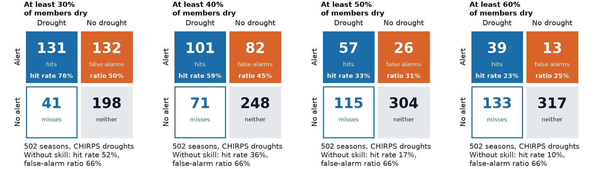

The same four thresholds as a 2×2 matrix: all years, the forecast one month before the season.

---

<!-- _class: chart -->

## Appendix: by region-season, at least 30% of members dry

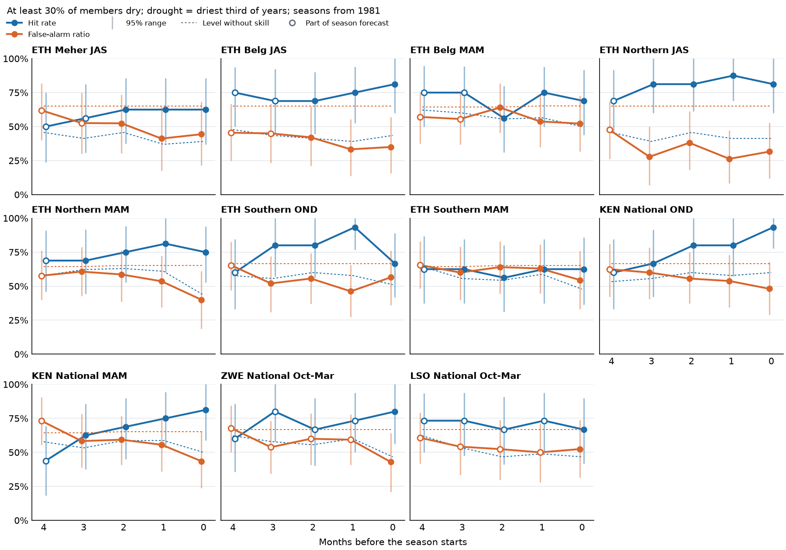

---

<!-- _class: chart -->

## Appendix: by region-season, at least 50% of members dry

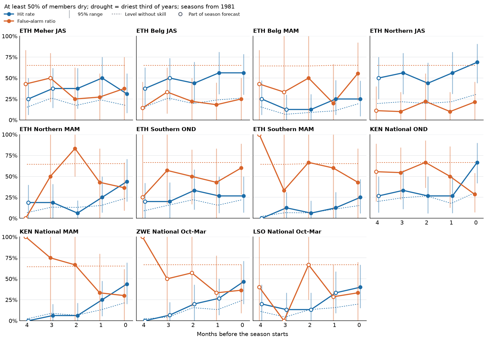

---

<!-- _class: chart -->

## Appendix: by region-season, at least 60% of members dry

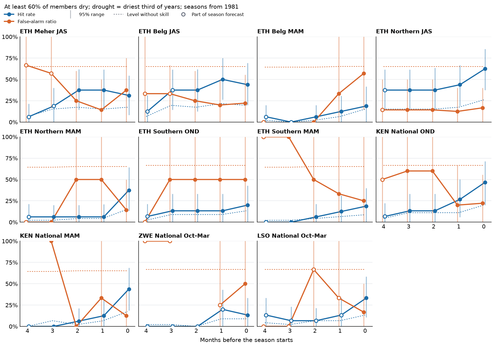

---

<!-- _class: chart -->

## Appendix: skill by period

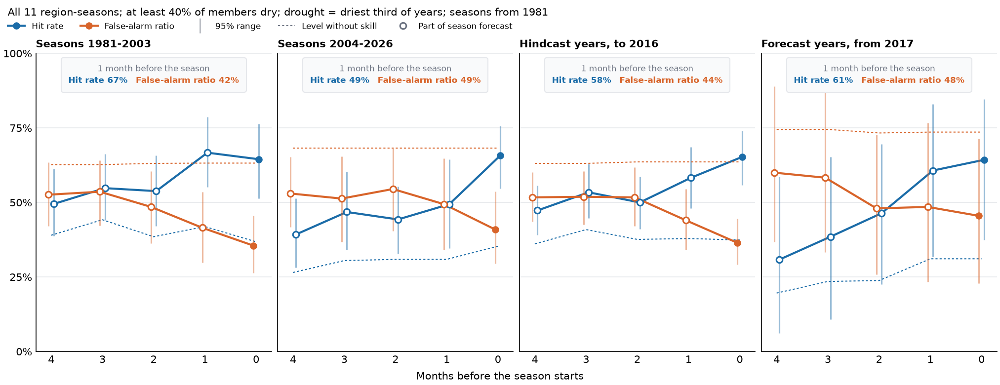

The forecast years from 2017 hold only 28 droughts. Removing linear trends barely changes the link between forecast and observed rainfall: for ETH Northern JAS the correlation goes from 0.72 to 0.67.

---

<!-- _class: small -->

## Appendix: IOD method, last month's index scored the same way as SEAS5

- **Index:** the Dipole Mode Index: sea surface temperature in the western Indian Ocean minus the east, against normal. Observed, not forecast.
- **Value at a run:** the index of the month before the run month, as in the proposed rule. It assumes that month is published in time.
- **Direction:** a negative index goes with drought in the short rains (southern Ethiopia and Kenya OND), a positive index with drought in Zimbabwe (Oct–Mar, OND, JFM).
- **Alert:** the index is in the outer third of its own values for that run month in the other years. That alerts in a third of the years; the 40% SEAS5 rule alerts in 34 to 42%.
- **Drought, measures, lead times:** as for SEAS5, which is scored here on the seasons that also have an index. Each region-season has 14 to 16 droughts in 44 or 45 seasons.
- **ROC area:** whether drought years score higher than other years, whatever the threshold. The review's bar: at least 0.6 and unlikely by chance.
- **Combined alerts:** either, or both, set next to SEAS5 alone at 30% and 50%: a combination also changes how often there is an alert.
- **Source:** NOAA OISST, weekly values averaged per month; a choice to revisit. Three other sources are scored as a check.
- **Also scored:** a fixed threshold of 0.4 °C (same picture) and a four-month average of the index (steadier for Zimbabwe, no better for the short rains).

---

<!-- _class: chart -->

## Appendix: IOD tells drought years apart about as well as SEAS5, and rarely better

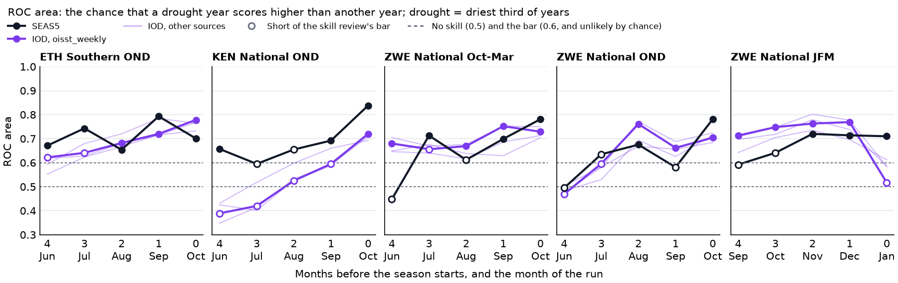

Southern Ethiopia OND, Kenya OND and Zimbabwe Oct–Mar together, from four months before to the season start: 0.57, 0.57, 0.63, 0.69 and 0.74 for IOD, against 0.61, 0.67, 0.64, 0.72 and 0.78 for SEAS5. The four sources give the same picture. They differ most for Zimbabwe, where the two OISST sources score up to 0.12 higher than the others.

---

<!-- _class: chart -->

## Appendix: IOD for the short rains, by forecast month

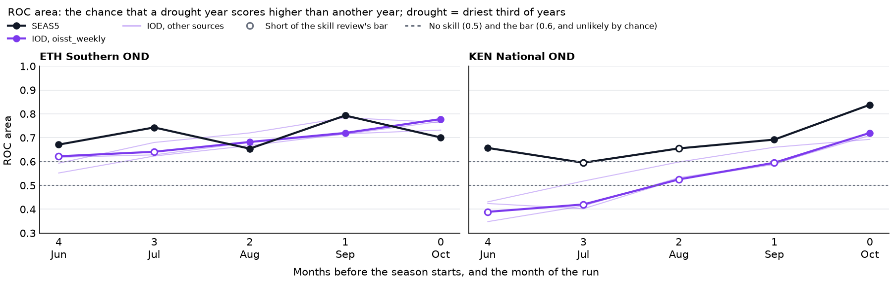

The review grades IOD Include from July and SEAS5 from August. Here IOD passes the bar from August in southern Ethiopia and only in October in Kenya. In June and July the Kenya index says nothing about drought (0.39 and 0.42). For the wettest third of seasons the opposite phase does better: it passes the bar from August in Kenya and from July in southern Ethiopia.

---

<!-- _class: chart -->

## Appendix: IOD for Zimbabwe, by forecast month

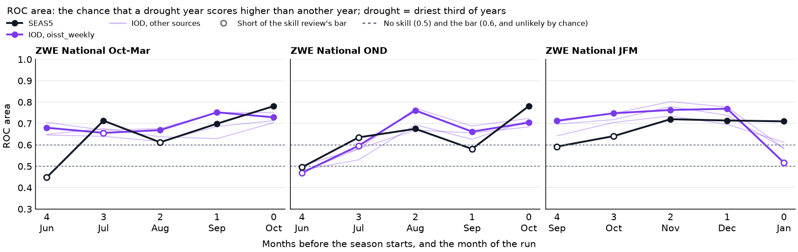

Whatever the threshold, the index tells drought years apart earlier than its alert beats chance. JFM: IOD passes the bar from the September forecast, SEAS5 from November. Oct–Mar: IOD passes in June, where SEAS5 is at 0.45. By January the index has lost its skill. In October the four sources range from 0.70 to 0.75.

---

<!-- _class: small -->

## Appendix: FEWS NET method, the projected area in Phase 3 or worse

- **Data:** FEWS NET classifications per area, 2011 to 2026: the current situation three times a year, plus a near-term and a medium-term projection, monthly from 2019–20. There are no reports from the end of 2024 to August–October 2025.
- **Value:** the share of the region's area in Phase 3 (Crisis) or worse. An area counts towards the region that holds its centre.
- **At a run:** the latest report from before the run month, and of that report the projection that covers most of the season.
- **Alert:** the share is in the upper third of the region's own shares for that run month. A fixed share does not work: in southern Ethiopia about 70% is in Phase 3 or worse in a usual year.
- **Second rule, projected worsening:** the projection is above the latest current situation, by more than is usual for that month.
- **Scored as SEAS5:** the same droughts and measures, on 10 region-seasons in Ethiopia, Kenya and Zimbabwe. About 150 seasons with 40 droughts: 26% of seasons, so random alerts would be false 74% of the time.
- **Not scored:** Lesotho, with four to six seasons and the country as one area.
- **Limits:** area, not people. Each region-season has 14 to 16 seasons with 1 to 6 droughts, so the conclusions rest on the numbers for all together.

---

<!-- _class: chart -->

## Appendix: Phase 3 is the usual state of some regions, so the alert is relative to the region

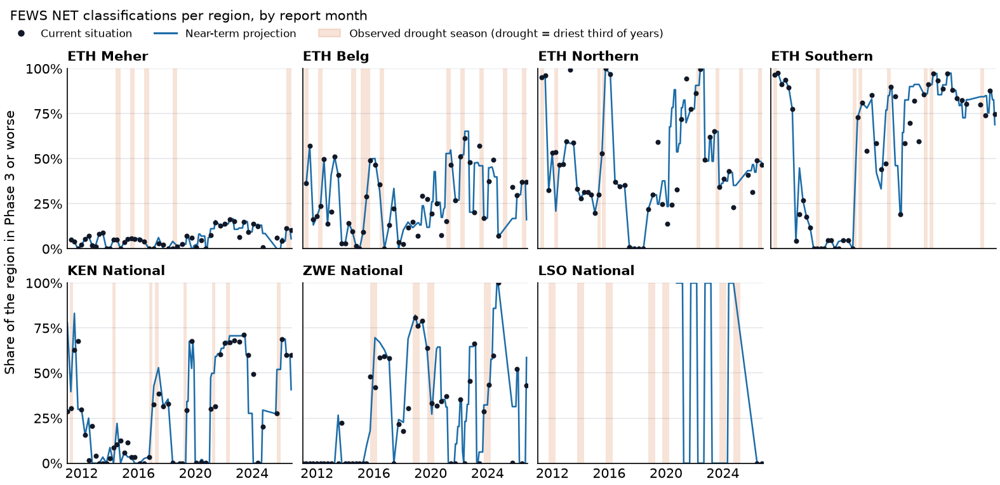

Shaded: the seasons in the driest third. In several regions the area rises after a shaded season, not before it. Lesotho is one area up to 2024, so its share is 0 or 100%.

---

<!-- _class: small -->

## Appendix: the review grades when FEWS NET reaches the impact, not whether it sees a dry season

- **What the review graded:** a month is Include when its near-term projection reaches the impact window: the last two months of the season to three months after. That follows from the publication calendar.
- **Its evidence** is how often projections match FEWS NET's own later classification: 78% for the near-term projection, 84% overall in the studies it cites. Our check agrees: 79% of projected changes point the right way.
- **What we measured:** whether that projection is higher in the seasons that turn out dry. It is not, until the season has ended.
- **Both hold.** A projection can be right about food insecurity and still say nothing about the rain. Most of it is the usual state of the region and what earlier seasons left behind.
- **For an event defined on rainfall,** FEWS NET should not raise an alert on its own in the Include months. The months after the season, which the review grades Readiness as confirmation, are where it does show the drought.
- **The review points the same way:** it notes that FEWS NET projections assume the seasonal outlook, so they are an impact gate, not an independent vote.

---

<!-- _class: small -->

## Appendix: FEWS NET as the outcome to score on? As a check, not as a replacement

| Outcome an alert is scored on, one month before | Events in 145 seasons | Caught by SEAS5 | False alarms | False alarms without skill |
| ----------------------------------------------- | --------------------- | --------------- | ------------ | -------------------------- |
| Dry season: rainfall in the driest third        | 39                    | 22 (56%)        | 51%          | 73%                        |
| Impact season: a clear rise after the season    | 48                    | 20 (42%)        | 56%          | 67%                        |
| Dry season that is followed by a clear rise     | 25                    | 14 (56%)        | 69%          | 83%                        |

A clear rise: the area in Phase 3 or worse in the six months after the season is above the level before it, by an amount in the upper third for that region-season.

- **The two outcomes overlap in part.** Of the 39 dry seasons, 25 are followed by a clear rise. Another 23 rises follow a season that was not dry.
- **SEAS5 holds up on the droughts that had impact:** it catches 56% of them, as of all dry seasons.
- **Why not replace rainfall:** 15 years instead of 45, and nothing for Lesotho. Food insecurity also follows conflict, prices and the season before. A rise lags and lasts, so with two seasons a year it is unclear which season it belongs to. And the definition has many settings to tune.
- **What it is for:** a check that the rainfall outcome is about droughts that matter, and a third opinion on disputed seasons, next to CHIRPS and the reported droughts.
