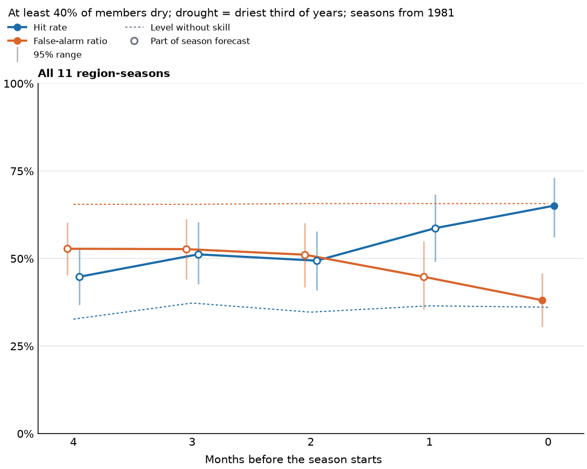
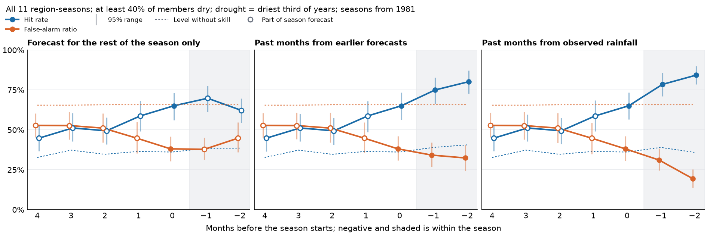
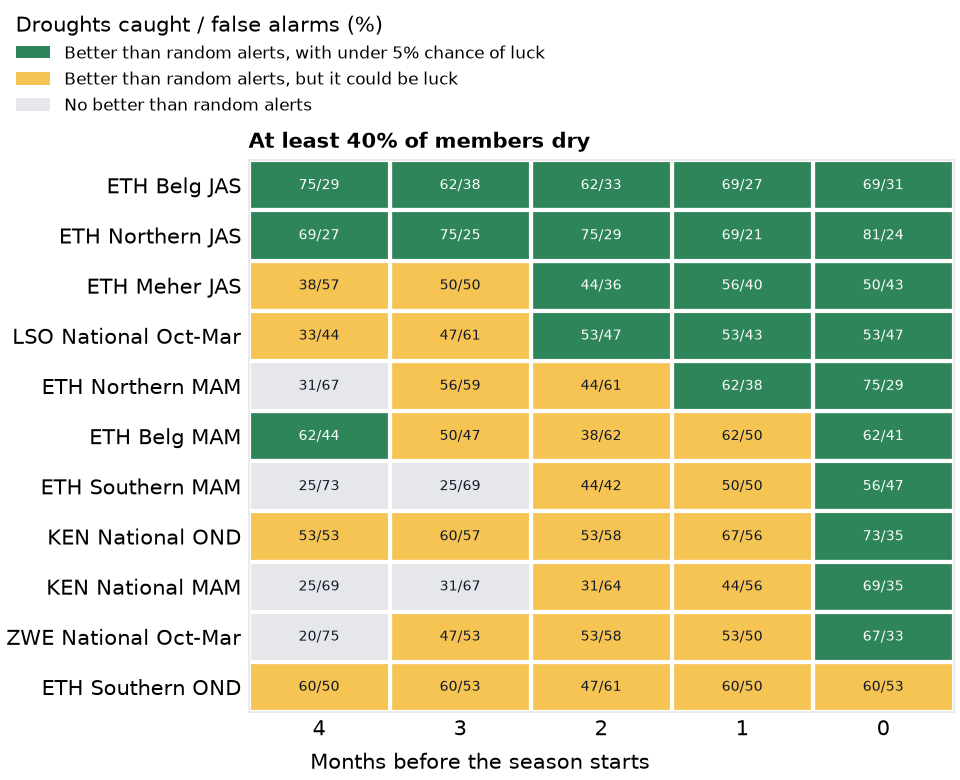
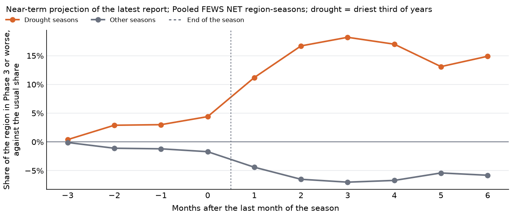
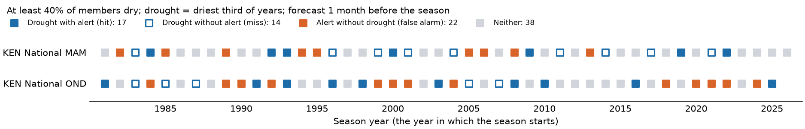
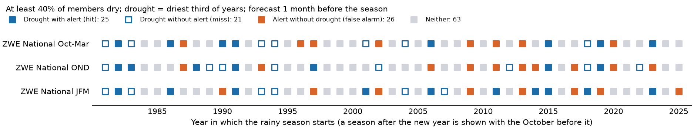
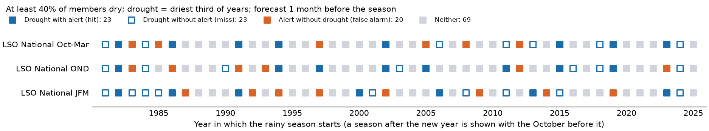

# Drought alerts in NRW: what 46 years of forecasts show, and what to decide

Summary for product decisions, 18 November 2026

Preliminary conclusions: the definitions are not yet agreed. The analysis behind every number is in the technical deck, `drought_hindcast_slides`.

---

<!-- header: Conclusions -->

## In short

- **A drought alert from the seasonal rainfall forecast (SEAS5) works.** One month before the season it catches 59% of droughts, and 45% of its alerts are false. Random alerts would score 36% and 66%.
- **Start with SEAS5 only.** It has skill in all four countries, and the results line up with the skill review and with the triggers that National Societies already use.
- **How early an alert is reliable differs:** four months ahead for the main rains in northern Ethiopia, the season start for most others. So alerts at and after the season start are needed, and they get better within the season.
- **40% is a good default threshold.** The threshold is also a choice between missed droughts and false alarms: a setting per region and season, to make with the National Society.
- **IOD adds little** and is left out, except possibly for Zimbabwe, where the early action protocol is built on it.
- **FEWS NET is a different alert:** about food insecurity, not about rainfall. That is a later slice and a product decision.

---

## How it was tested

- **Where and when:** 11 combinations of region and season in Ethiopia, Kenya, Zimbabwe and Lesotho, 1981 to 2026. That is 502 seasons, 172 of them droughts.
- **Alert:** at least 40% of the forecast's runs (its members) put the season's rainfall in the driest third.
- **Drought:** the season's observed rainfall was in the driest third of years.
- **Droughts caught:** the share of droughts that had an alert. Higher is better.
- **False alarms:** the share of alerts that had no drought. Lower is better.
- **Random alerts** are the yardstick. Issued as often, they catch about 36% of droughts and are false 66% of the time.

---

<!-- _class: small -->

## The alert has skill before the season, and gets better into it

| Forecast, all 11 region-seasons together       | Droughts caught | False alarms |
| ---------------------------------------------- | --------------- | ------------ |
| Four months before the season                  | 45%             | 53%          |
| One month before                               | 59%             | 45%          |
| At the season start                            | 65%             | 38%          |
| One month into the season, rain so far counted | 78%             | 31%          |
| Two months into the season                     | 84%             | 19%          |
| Random alerts, for comparison                  | about 36%       | 66%          |

- **Within the season** the forecast for the remaining months is added to the rain that has fallen. That needs last month's rainfall at the forecast date, which is still to be checked.
- **On the 24 cases of 2025–26 that were reviewed by hand before,** this alert catches 9 of the 11 reported droughts, where the earlier IBF system caught 4. Those two years flatter it: over all years it is 59%.
- **Checked:** a second, separate calculation gives the same alerts, and both halves of the period score above random.

---

<!-- _class: small dense -->

## From when can an alert be relied on?

| Region and season | Alerts reliable from  | Droughts caught / false alarms then | Weaker evidence from | One month into the season |
| ----------------- | --------------------- | ----------------------------------- | -------------------- | ------------------------- |
| ETH Northern JAS  | 4 months before       | 69% / 27%                           |                      | 88% / 26%                 |
| ETH Belg JAS      | 4 months before       | 75% / 29%                           |                      | 88% / 18%                 |
| ETH Meher JAS     | 2 months before       | 44% / 36%                           | 4 months before      | 75% / 37%                 |
| LSO Oct–Mar       | 2 months before       | 53% / 47%                           | 4 months before      | 87% / 28%                 |
| ETH Northern MAM  | 1 month before        | 62% / 38%                           | 3 months before      | 88% / 30%                 |
| ETH Belg MAM      | season start          | 62% / 41%                           | 4 months before      | 75% / 29%                 |
| ETH Southern MAM  | season start          | 56% / 47%                           | 2 months before      | 69% / 42%                 |
| KEN MAM           | season start          | 69% / 35%                           | 2 months before      | 75% / 29%                 |
| KEN OND           | season start          | 73% / 35%                           | 4 months before      | 73% / 35%                 |
| ZWE Oct–Mar       | season start          | 67% / 33%                           | 3 months before      | 53% / 53%                 |
| ETH Southern OND  | not before the season | 60% / 53% at the season start       | 4 months before      | 93% / 12%                 |

With the 40% threshold. **Reliable:** better than random alerts, with under 5% chance that it is luck, at that forecast and every later one. **Weaker evidence:** better than random alerts from then on, but it could be luck. Each row rests on 15 or 16 droughts.

---

<!-- _class: small -->

## The results line up with what is known and used already

- **The skill review, from literature:** of the 16 months it grades sufficient for SEAS5, 14 pass its own bar here. The pattern is the same: early for the main rains in northern Ethiopia, late for March to May. With the 40% threshold, mainly the short rains (OND) are weaker before the season than it expects.
- **The triggers in the drought early action protocols (EAPs):**

| Country  | Trigger in the EAP                                                                                  | Here                                                                                |
| -------- | --------------------------------------------------------------------------------------------------- | ----------------------------------------------------------------------------------- |
| Ethiopia | Seasonal rainfall forecast one month before, at 40 to 45%. A second trigger a month into the season | Reliable by the season start for six of seven region-seasons, and better a month in |
| Kenya    | Seasonal forecast for OND at 33%, from July                                                         | Reliable from September at 30%, from October at 40%                                 |
| Lesotho  | Seasonal outlook in September for OND. Later: observed rainfall and food security                   | Reliable from September for OND                                                     |
| Zimbabwe | The observed IOD index, before the season                                                           | IOD scores like SEAS5 from October                                                  |

The triggers come from an overview of EAPs and are not checked against the protocols themselves. They use other forecasts and drought measures, so only timing and thresholds compare.

---

<!-- _class: small -->

## Proposed slices

| Slice            | What                                                                                                  | Why                                                                                                                          |
| ---------------- | ----------------------------------------------------------------------------------------------------- | ---------------------------------------------------------------------------------------------------------------------------- |
| First            | A SEAS5 alert in all four countries: 40% as default, from the first reliable month through the season | It has skill everywhere, and is in line with the skill review and the EAP triggers                                           |
| First, if needed | IOD for Zimbabwe                                                                                      | The EAP is built on it. Here it scores like SEAS5 from October. It also sets up more than one indicator in the configuration |
| Later            | FEWS NET, as a separate alert about food insecurity                                                   | A different alert. A product decision, and it needs a check against an independent outcome first                             |
| Not planned      | IOD elsewhere. Several indicators in one alert. Separate alerts per indicator                         | IOD adds little. Mixing changes what the alert means. Separate alerts are a larger feature                                   |

---

<!-- header: Levers -->
<!-- _class: small -->

## The levers, and who decides

| Lever                                                       | Preliminary position                                    | Who decides                          |
| ----------------------------------------------------------- | ------------------------------------------------------- | ------------------------------------ |
| How the alert and the drought are calculated                | Fixed, as tested here                                   | The team, with the hazard experts    |
| Threshold per region and season                             | 40% as default; 30% for Kenya OND as a candidate        | With the National Society            |
| Alerts at and after the season start                        | Yes, without a hard cut-off                             | The team                             |
| How much evidence an alert needs                            | Three levels instead of pass or fail                    | The team                             |
| Alerting earlier on weaker evidence, with an advisory label | Open                                                    | Product, then the National Society   |
| Season for Zimbabwe and Lesotho                             | Oct–Mar, with Jan–Mar as a possible second alert moment | With the National Society            |
| IOD for Zimbabwe                                            | Open, pending a comparison with the EAP's own analysis  | The team, given the EAP              |
| Rainfall or food insecurity (FEWS NET)                      | Rainfall first; food insecurity as a later slice        | Product, with the National Societies |

The next four slides take the levers that need a choice.

---

<!-- _class: small -->

## Lever: the threshold is a choice between missed droughts and false alarms

| Threshold, one month before | Droughts caught | False alarms | Seasons with an alert | Region-seasons with a reliable alert |
| --------------------------- | --------------- | ------------ | --------------------- | ------------------------------------ |
| 30% of members dry          | 76%             | 50%          | 52%                   | 7 of 11                              |
| 40%                         | 59%             | 45%          | 36%                   | 10 of 11                             |
| 50%                         | 33%             | 31%          | 17%                   | 7 of 11                              |
| 60%                         | 23%             | 25%          | 10%                   | 6 of 11                              |

- **40% is the best single default:** it gives the most region-seasons a reliable alert.
- **There is no sweet spot.** A lower threshold catches more droughts and alerts more often. Which error costs more, a missed drought or a false alarm, is for the user to say.
- **Example, Kenya OND:** at 30% the alert is reliable from September instead of October, with 80% of droughts caught, 54% false alarms and an alert in 58% of years. Kenya's EAP triggers at 33%.
- **Offer it per region and season, with these numbers.** Do not fit it for them: each has 15 or 16 droughts, so a fitted threshold would mostly fit noise.
- **Also possible:** two levels, an early notice at a low threshold and action at a higher one.

---

<!-- _class: chart small -->

## Lever: alerts at and after the season start

- **Without alerts at the season start,** five region-seasons have no reliable alert at all.
- **Within the season the alert keeps improving, if the rain so far is counted** (right panel). One month in, the alert is clearly better than random in 10 of 11 region-seasons. Southern Ethiopia OND gets its first one then: 93% of droughts caught with 12% false alarms.
- **A hard cut-off at the season start does not fit either:** in some countries the start of the season is not sharply defined.
- **Preliminary conclusion:** alert through the season, with the rain so far counted.

---

<!-- _class: small -->

## Lever: an advisory level for alerts on weaker evidence

Each cell is one forecast month of a region and season, coloured by how its alerts scored over all years.

| Level         | Cells | Droughts caught / false alarms |
| ------------- | ----- | ------------------------------ |
| Green         | 24    | 64% / 35%                      |
| Yellow        | 25    | 50% / 55%                      |
| Grey          | 6     | 26% / 70%                      |
| Random alerts |       | about 35% / 66%                |

- **Now only green counts as reliable,** and its 5% line is sharp: Lesotho two months before is just inside, Kenya OND one month before is outside, at 12%.
- **A line at 10%** would turn 8 of the 25 yellow cells green.
- **To decide:** show yellow as an alert with an advisory label, or not at all. About half of those alerts were false.

---

## Lever: what the alert is about, rainfall or food insecurity

- **FEWS NET gives an outlook on food insecurity,** whatever the cause. It does not announce a dry season: it reflects one two to three months after it (chart).
- **The two overlap in part.** A rise in food insecurity follows 64% of dry seasons and 22% of other seasons. About half of all rises follow a season that was not dry.
- **So it is a different alert,** not a second vote on the SEAS5 alert. The skill review's grade for FEWS NET rests on its publication calendar, not on measured skill.
- **Options:** rainfall only, as now. A menu per National Society, with one meaning per alert. Or both as separate alerts, which is a larger feature.
- **To find out with users:** do they need to know that the rains are likely to fail, or that food insecurity is expected?

---

<!-- header: Countries -->
<!-- _class: small dense -->

## Ethiopia: early for the main rains, at the season start for March to May

| Region and season | Alerts reliable from          | Droughts caught / false alarms then | One month into the season |
| ----------------- | ----------------------------- | ----------------------------------- | ------------------------- |
| Northern JAS      | March, 4 months before        | 69% / 27%                           | 88% / 26%                 |
| Belg JAS          | February, 4 months before     | 75% / 29%                           | 88% / 18%                 |
| Meher JAS         | April, 2 months before        | 44% / 36%                           | 75% / 37%                 |
| Northern MAM      | February, 1 month before      | 62% / 38%                           | 88% / 30%                 |
| Belg MAM          | February, at the season start | 62% / 41%                           | 75% / 29%                 |
| Southern MAM      | March, at the season start    | 56% / 47%                           | 69% / 42%                 |
| Southern OND      | not before the season         | 60% / 53% at the season start       | 93% / 12%                 |

- **Main rains (JAS):** alerts can be acted on from February or March in the north and the Belg area.
- **March to May:** an alert is reliable only when the season is about to start.
- **Southern OND:** no threshold gives a reliable alert before the season, and IOD does not either. One month in, with October's rain counted, the alert catches 14 of 15 droughts.
- **Years:** 2015 and 2026 were caught in all three JAS seasons. The Meher droughts of 1999 to 2009 were missed.
- **In line with the EAP,** which triggers one month before the season and again a month into it.

---

<!-- _class: chart small -->

## Kenya: reliable at the season start, and for OND the threshold is a choice

| Season | Alerts reliable from         | Droughts caught / false alarms then | One month into the season |
| ------ | ---------------------------- | ----------------------------------- | ------------------------- |
| MAM    | March, at the season start   | 69% / 35%                           | 75% / 29%                 |
| OND    | October, at the season start | 73% / 35%                           | 73% / 35%                 |

- **OND at 30%** is reliable from September: 80% of droughts caught, 54% false alarms, an alert in 58% of years.
- **MAM months ahead:** the forecast itself is weak there, so no threshold helps.
- **Open, OND 2020 to 2022:** the alerts count as false alarms, in years known as the Horn drought. National rainfall was not in the driest third, and scoring on the arid counties changes only 2022. A second rainfall source is the next check.

---

<!-- _class: chart small -->

## Zimbabwe: October for the whole season, and IOD is the open question

| Season scored         | Alerts reliable from         | Droughts caught / false alarms then |
| --------------------- | ---------------------------- | ----------------------------------- |
| Whole season, Oct–Mar | October, at the season start | 67% / 33%                           |
| Second half, Jan–Mar  | November, 2 months before    | 62% / 44%                           |

- **Most droughts sit in Jan–Mar:** 13 of the 15 whole-season droughts. So Jan–Mar is a candidate for a second alert moment, and a month into the season the alert does not improve.
- **IOD scores like SEAS5 from October.** For the whole season it adds nothing to the SEAS5 alert. For Jan–Mar it gives a reliable alert in October, a month before SEAS5.
- **The EAP is built on IOD.** Whether that is worth a second indicator needs a comparison with the EAP's own analysis.

---

<!-- _class: chart small -->

## Lesotho: a thin first measurement

| Season scored         | Alerts reliable from         | Droughts caught / false alarms then |
| --------------------- | ---------------------------- | ----------------------------------- |
| Whole season, Oct–Mar | August, 2 months before      | 53% / 47%                           |
| First half, OND       | September, 1 month before    | 53% / 43%                           |
| Second half, Jan–Mar  | January, at the season start | 56% / 40%                           |

- **Only just reliable:** the alerts catch about half of the droughts, and with one hit fewer they would not pass. One month into the season it is 87% with 28% false alarms.
- **2024–25 was missed:** dry in the rainfall data, no alert, and no drought reported. To check against a second rainfall source.
- **In line with the EAP,** which uses the September outlook for OND.

---

<!-- header: Next -->
<!-- _class: small -->

## What to decide, and what follows

**Product decisions**

1. Is the first slice SEAS5 only, and is IOD for Zimbabwe in or out?
2. Is the threshold a setting per region and season, chosen with the National Society?
3. Do we show alerts on weaker evidence, with an advisory label?
4. What is a drought alert about: rainfall, or food insecurity? A question for user research.

**To confirm with the hazard experts**

- The definitions: the driest third as drought, the seasons, and Oct–Mar for Zimbabwe and Lesotho.

**Analysis to follow**

- Zimbabwe: IOD against the EAP's own analysis.
- FEWS NET against an independent outcome, such as crop yields or food prices.
- Whether last month's rainfall is available in time for alerts within the season.
- A second rainfall source, for Kenya OND 2020 to 2022 and Lesotho 2024–25.
- Why the earlier IBF system did worse on the 2025–26 cases.

---

## What to keep in mind

- **Drought here is low rainfall, not impact.** The two can disagree in both directions.
- **One rainfall source.** CHIRPS is the only truth here.
- **Small samples per region and season:** 15 or 16 droughts each. Patterns that repeat count, single numbers do not.
- **Choices made on these numbers are flattered by them.** A threshold or evidence level picked on these years will do a little worse on new ones.
- **The definitions are not yet agreed** with the hazard experts.
