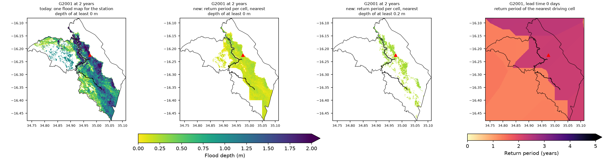
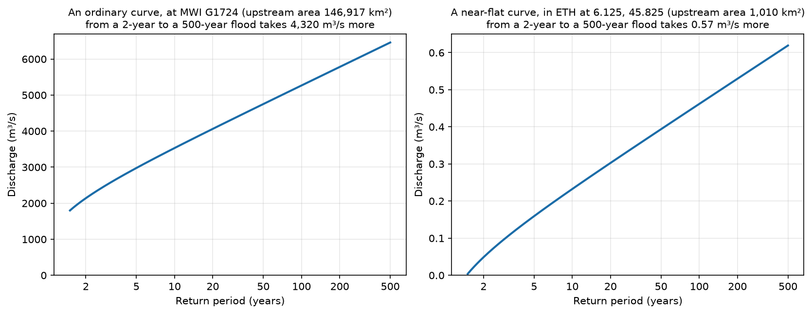
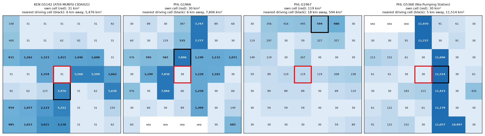

# The flood footprint now follows the rivers that are in flood

First implementation of the CLIMADA method in the NRW flood pipeline, one slice of AB#42674. Draft of 18 November 2026: not merged, and the settings are not agreed.

**The alert does not change.** The station still decides whether there is an alert. On the Malawi forecast of 2 September 2026, old and new code give the same three alerts, with the same severities and discharge chart.

**The footprint is new**, in three steps:

1. **Return period per GloFAS cell**, on the cell's own curve, on the day the station peaks.
2. **Onto the flood map.** Each 90 m pixel takes the return period of the nearest cell on a large river (upstream area of at least 500 km²).
3. **Depth.** Interpolated between the JRC flood maps, from zero at 1 year. Below 1.5 years a pixel stays dry.

**The curves are ECMWF's own**, for GloFAS v4. All 73 station thresholds lie exactly on the v4 curve of their cell, so the trigger and the footprint use the same curves. Where our thresholds came from was not known before.

---

<!-- _class: chart -->

## Malawi, 2 September: the calm river drops out, and the water is shallow

Station G2001, in alert at 2 years. Today's footprint is the whole 10-year map, up to 5.2 m deep. The new one leaves out the tributary in the west, which is at base flow, and is at most 0.7 m deep: at 2 years the depth is about a seventh of the 10-year depth. The straight edges are the borders between GloFAS cells.

---

<!-- _class: small -->

## Fewer people exposed, and only a minimum depth makes that number follow severity

Exposed population for the three alerts, all at 2 years:

| Station  |  Today | New, any depth | New, at least 0.2 m |
| -------- | -----: | -------------: | ------------------: |
| G1724    |  9,136 |          2,166 |                 381 |
| G2001    | 16,273 |         10,568 |               1,294 |
| Chikwawa |  1,117 |            741 |                 138 |

The same forecast for G1724 with the discharge multiplied, to mimic a larger flood on the Shire:

| Return period at the station's cell | 2.2 years | 5.1 years | 8.9 years | 21.3 years |
| ----------------------------------- | --------: | --------: | --------: | ---------: |
| New, any depth                      |     2,166 |     2,166 |     2,166 |      2,362 |
| New, at least 0.2 m                 |       381 |     1,589 |     1,859 |      2,129 |

- **Which rivers flood** changes the footprint with or without a minimum depth: calm cells are dry.
- **How severe the flood is** only changes the depth below 10 years, not the extent. Without a minimum depth, a 2-year and a 9-year flood on one river expose the same people.
- The test keeps the tributaries calm. In a real larger event more rivers would pass 1.5 years.

---

<!-- _class: small -->

## From prototype to pipeline: importing CLIMADA would save 230 of 3,500 lines

A CLIMADA run in a notebook is about 20 lines because the package (about 1,700 lines) brings the rest: it downloads the forecast, its own flood maps (the older JRC maps, about 1 km) and its own curves (fitted at ETH on GloFAS 1979–2015).

| Part                                                  | Lines | With CLIMADA imported                                   |
| ----------------------------------------------------- | ----: | ------------------------------------------------------- |
| The method: return period, regridding, depth          |   230 | Replaced, plus an adapter                               |
| Wiring into the pipeline, fallbacks, empty footprints |   360 | Stays                                                   |
| The curves as an input: seed script, file, loader     |   410 | Stays; CLIMADA's curves are not those of our thresholds |
| Unit tests                                            | 1,300 | Mostly stays                                            |
| Comparison and curve check, not part of the pipeline  | 1,190 | Stays                                                   |

**What importing costs:**

- **Dependencies.** CLIMADA's regridding needs ESMF, which is not on PyPI, so it does not fit our `uv` image as it is.
- **Data layout.** It wants all flood maps merged into one file; ours loads only the maps it needs, inside the alert's area.
- **Licence.** CLIMADA is GPL-3, our pipeline is Apache-2.0.

**Proposal:** keep our own implementation, and check it against the prototype on one forecast. Not done yet.

---

<!-- _class: small -->

## To decide

Tested so far on one forecast only: Malawi, 2 September 2026, three alerts at 2 years.

| Decision                      | Now in the draft                                                 | Why it needs a decision                                                                                   |
| ----------------------------- | ---------------------------------------------------------------- | --------------------------------------------------------------------------------------------------------- |
| **Minimum depth**             | 0.2 m, for the map and for exposed population                    | Exposed population falls to 4–12% of today's at 2 years. Without it, the number ignores severity.         |
| **Near-flat curves**          | Cells with a curve scale below 1 m³/s do not drive the footprint | Not in the original plan. It concerns 17–40% of the large-river cells in Ethiopia, Kenya and South Sudan. |
| **Stations on small streams** | Their own cell does not drive the footprint                      | Four stations. Three sit one cell beside a large river, so this is about where the station is placed.     |
| **Empty footprint**           | The alert stays, with its whole area and nobody exposed          | Not yet checked in the API and the front end.                                                             |
| **Import CLIMADA**            | Own implementation                                               | See the previous slide.                                                                                   |

**Before merging:** the seven curve files (4.7 MB) go into the seed repo first. Without them the flood pipeline fails for every country.

The next three slides explain the rows on near-flat curves, stations on small streams and the empty footprint.

---

<!-- _class: small -->

## Near-flat curves: a trickle turns a 2-year flood into a 500-year one

- **The curve of a cell** turns discharge into a return period. Its scale says how much the yearly peak varies. In dry riverbeds the scale is almost zero, so a trickle more water moves the cell from 2 to 500 years.
- **The rule in the draft:** a cell with a scale below 1 m³/s does not drive the footprint. Its pixels take the nearest cell that does.
- **Large-river cells this switches off:** Kenya 40%, Ethiopia 22%, South Sudan 17%, Uganda 5%, Zambia 1%, Malawi and the Philippines none.
- **To decide:** whether to have the rule, and at which value. Its cost is that a real flash flood in such a riverbed does not show in the footprint.

---

<!-- _class: small -->

## Stations on small streams: three of the four sit one cell beside a large river

Upstream area in km² around each station. Red: the station's cell. Black: the nearest cell that drives the footprint.

- **The alert uses the red cell and the footprint the black one.** For G5142, G1966 and G5368 a stream of 30 km² triggers the alert, and the footprint follows the river of 5,000 to 12,000 km² beside it.
- **These three look like stations for the large river, placed one cell off**, as the name Athi Munyu suggests. This is not checked against the real station locations. G1967 is on a small stream of its own.
- **To decide:** where these stations belong. That is about station placement more than about the footprint, and moving them changes their thresholds.

---

<!-- _class: small -->

## Empty footprint: the alert stays, with nobody exposed

**When it happens:** the station is in alert, but no pixel in its area floods. Either no driving cell in its area reaches 1.5 years, or the water is nowhere deeper than 0.2 m. It did not happen in the Malawi test.

|                              | Alert with a footprint        | Alert with an empty footprint |
| ---------------------------- | ----------------------------- | ----------------------------- |
| Severity and discharge chart | As today                      | As today                      |
| Admin areas listed           | Those the footprint touches   | All areas of the alert        |
| Exposed population           | Per area                      | 0 for each area               |
| Flood map                    | Depth inside the alert's area | Blank                         |

- **Why the alert stays:** the station is the trigger, so an alert must not disappear because of the footprint.
- **What does not change:** an alert is still skipped when the flood maps do not cover its area at all, as decided earlier (#443).
- **Checked:** a unit test runs such an alert through the forecast and the pipeline's integrity checks.
- **Not checked:** whether the API accepts a blank flood map and how the front end shows it. That needs one test on a local or test environment before merging.
