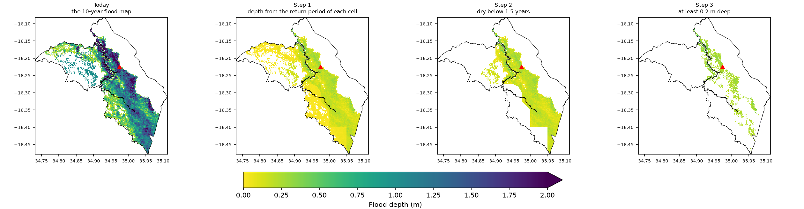
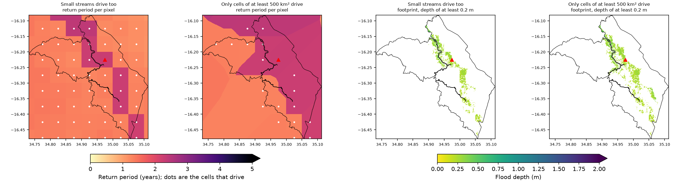
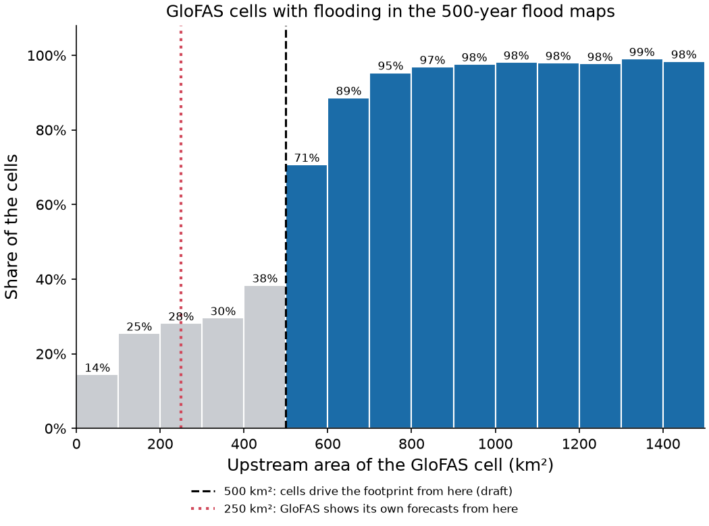
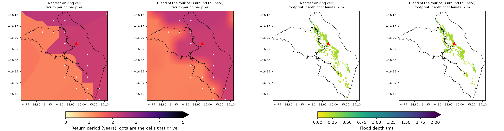

# The flood footprint now follows the rivers that are in flood

Draft of 25 November 2026 for AB#42674, the CLIMADA method in the NRW flood pipeline. Not merged; the settings are not agreed.

- **The alert does not change.** The station still decides. On the Malawi forecast of 2 September 2026, old and new code give the same three alerts.
- **The footprint is new.** Each GloFAS cell gets a return period from its own curve. That return period sets the depth of the flood map pixels around it.
- **The curves are ECMWF's, for GloFAS v4.** All 73 station thresholds lie exactly on them.

---

## Malawi, 2 September: from today's footprint to the new one in three steps

Station G2001, in alert at 2 years.

1. **Depth from the return period of each cell.** The same extent as today, but much shallower.
2. **Dry below 1.5 years.** The rivers at base flow drop out.
3. **At least 0.2 m deep.** Thin water drops out.

---

<!-- _class: small -->

## Only step 3 makes the number of people exposed follow severity

Exposed population after each step, for the three alerts, all at 2 years:

| Station  |  Today | Step 1 | Step 2 | Step 3 |
| -------- | -----: | -----: | -----: | -----: |
| G1724    |  9,136 |  9,136 |  2,166 |    381 |
| G2001    | 16,273 | 16,273 | 10,568 |  1,294 |
| Chikwawa |  1,117 |  1,117 |    741 |    138 |

G1724 again, with the discharge multiplied to mimic a larger flood, for a range of minimum depths:

| Return period at the station | 2.2 years | 5.1 years | 8.9 years | 21.3 years |
| ---------------------------- | --------: | --------: | --------: | ---------: |
| No minimum depth (step 2)    |     2,166 |     2,166 |     2,166 |      2,362 |
| At least 0.1 m               |     1,304 |     1,890 |     2,059 |      2,267 |
| At least 0.2 m (step 3)      |       381 |     1,589 |     1,859 |      2,129 |
| At least 0.3 m               |        84 |     1,373 |     1,662 |      1,983 |
| At least 0.5 m               |         3 |       850 |     1,448 |      1,765 |

- **Step 2 decides which rivers count.** A 2-year and a 9-year flood on one river still expose the same people.
- **Step 3 adds severity.** With it in place, leaving out step 2 gives the same numbers in this test.
- **The value matters most for low alerts.** From 0.2 to 0.3 m: 381 to 84 at 2.2 years, 1,859 to 1,662 at 8.9 years.

---

<!-- _class: small -->

## To decide

Tested on one forecast only: Malawi, 2 September 2026.

| Decision                | Now in the draft                               | Why it needs a decision                                                               |
| ----------------------- | ---------------------------------------------- | ------------------------------------------------------------------------------------- |
| **Dry below 1.5 years** | Step 2                                         | With step 3 in place it changes nothing in the test.                                  |
| **Minimum depth**       | Step 3, at 0.2 m                               | A definition of exposed. At a 2-year alert each 0.1 m changes the number severalfold. |
| **Small streams**       | Cells below 500 km² do not drive the footprint | Two questions: have the rule at all, and from which size.                             |
| **Regridding**          | A pixel takes the nearest cell                 | CLIMADA blends cells, which exposes up to a third fewer people.                       |
| **Empty footprint**     | The alert stays, with nobody exposed           | Today an alert without flood depth is dropped. The app can show either.               |
| **Import CLIMADA**      | Own implementation                             | Importing replaces 230 of 1,000 lines of pipeline code and adds heavy dependencies.   |

**Before merging:** the curve files have to merge into the seed repo first (draft PR). The next six slides take the last four rows in order.

---

<!-- _class: small -->

## Small streams, 1: their pixels follow the large river beside them

- **The rule:** a cell with an upstream area below 500 km² does not drive. Its pixels take the nearest cell that does (the dots).
- **What that does:** the pixels get the large river's return period. That is higher than the stream's own when the stream is calm (left, as in this test), and lower when the stream jumps on a small change in the forecast (why the rule was proposed).

| Where the flooding in the flood maps lies (seven countries) | Share of the wet pixels |
| ----------------------------------------------------------- | ----------------------: |
| In a cell of a large river (500 km² or more)                |                     57% |
| In a small-stream cell next to a large-river cell           |                     35% |
| Farther from a large river                                  |                      8% |

- **For:** the 35% is floodplain of the large river, in a cell that GloFAS counts as a small stream.
- **Against:** in the 8%, the rule overrides a small river's own flood.

---

<!-- _class: small -->

## Small streams, 2: the flood maps start at about 500 km²

- **Two datasets meet here.** A GloFAS cell's return period sets the depth of the flood-map pixels around it. That only fits where the flooding there is that cell's own river.
- **The flood maps start at about 500 km².** From 600 km², 89–99% of the cells have flooding. Below 500 km² it is 14–38%, and most of that flooding lies next to a large-river cell (35% against 8%, previous slide).
- **Documented:** the method behind the flood maps uses rivers from 500 km² (stated for the European maps, Dottori et al. 2022).
- **GloFAS itself starts lower:** it shows its own forecasts for rivers from 250 km² (dotted line). Between 250 and 500 km² there is a forecast but hardly a flood map.

---

<!-- _class: small -->

## Small streams, 3: from which size cells drive

| Cells drive from                                | No rule | 100 km² | 250 km² | 500 km² (draft) | 1,000 km² | 2,000 km² |
| ----------------------------------------------- | ------: | ------: | ------: | --------------: | --------: | --------: |
| People exposed at 0.2 m: G1724                  |     218 |     221 |     222 |             381 |       447 |       447 |
| People exposed at 0.2 m: G2001                  |     839 |   1,273 |   1,293 |           1,294 |     1,373 |     1,373 |
| People exposed at 0.2 m: Chikwawa               |     137 |     138 |     138 |             138 |       138 |       138 |
| Flooding more than one cell from a driving cell |      0% |      1% |      4% |              8% |       15% |       26% |

- **500 km² matches the flood maps** (previous slide), and the result is stable from there up: 381 to 447 for G1724.
- **100 or 250 km² interferes less:** only 1–4% of the flooding takes its return period from a cell more than one cell away, against 8%.
- **But it also does less:** G1724 stays at 221–222, against 218 with no rule. The cells of 250–500 km² beside the Shire still drive.
- **To decide:** the size.

---

<!-- _class: small -->

## Regridding: one river per pixel, or a blend of its neighbours

| People exposed at 0.2 m | Nearest (draft) | Bilinear |
| ----------------------- | --------------: | -------: |
| G1724                   |             381 |      250 |
| G2001                   |           1,294 |    1,070 |
| Chikwawa                |             138 |      133 |

- **Nearest:** a pixel takes one cell (the dots), so one river. The borders are sharp.
- **Bilinear:** a pixel blends the four cells around it, as CLIMADA does by default. The flood gets wider and thinner.
- **To decide:** nearest fits "a pixel takes the river that floods it". Bilinear softens the borders, where the nearest cell is only a guess.

---

<!-- _class: small -->

## Empty footprint: today the alert is dropped, the draft keeps it

| Why no pixel floods                                                                  | Today         | In the draft                      |
| ------------------------------------------------------------------------------------ | ------------- | --------------------------------- |
| **The flood maps do not cover the alert's area.** A data error, at 1 of 71 stations. | Dropped       | Dropped                           |
| **Nothing floods:** no cell at 1.5 years, or no water at the minimum depth.          | Cannot happen | Kept, with its areas at 0 exposed |

Of the other 70 stations, those with an empty footprint when every cell in their area is at one return period:

| Minimum depth | 0.1 m | 0.2 m (draft) | 0.3 m | 0.5 m |
| ------------- | ----: | ------------: | ----: | ----: |
| At 1.5 years  |     1 |             2 |     6 |    23 |
| At 2 years    |     0 |             1 |     1 |     3 |
| At 5 years    |     0 |             0 |     0 |     1 |

Checked in the app with a made-up forecast, for the stations in the 0.2 m column at their country's lowest alert level:

| Station                     | Alert level | What the app shows                                                      |
| --------------------------- | ----------: | ----------------------------------------------------------------------- |
| Woltkite, Ethiopia          |     2 years | Event "Low": 1 exposed woreda, 0 exposed people, no water on the map    |
| Manafwa at Butaleja, Uganda |   1.5 years | Event "Low": 6 exposed districts, 0 exposed people, no water on the map |

- **Keep, as in the draft:** it works without errors, but the app lists areas as exposed with nobody in them.
- **Drop, as today:** no flood depth, no alert. The minimum depth then also decides whether a low alert shows.

---

<!-- _class: small -->

## Import CLIMADA: it would replace 230 of the 1,000 lines of pipeline code

A CLIMADA notebook is about 20 lines because the package brings the rest: the forecast download, its own flood maps (older, about 1 km) and its own curves.

| Part                   | Lines | What it is                                                             | With CLIMADA imported                                   |
| ---------------------- | ----: | ---------------------------------------------------------------------- | ------------------------------------------------------- |
| The method             |   230 | Pipeline code: return period, regridding, depth                        | Replaced, plus an adapter                               |
| Wiring                 |   360 | Pipeline code: from forecast to alert, with the fallbacks              | Stays                                                   |
| The curves as an input |   410 | Pipeline code and the script that builds the files                     | Stays; CLIMADA's curves are not those of our thresholds |
| Unit tests             | 1,330 | Automatic checks of that code on small made-up inputs, run on every PR | Mostly stays                                            |

- **Dependencies:** its regridding needs ESMF, which is not on PyPI.
- **Data layout:** it wants all flood maps in one file.
- **Licence:** CLIMADA is GPL-3, our pipeline Apache-2.0.

**Proposal:** keep our own code, and check it against the prototype on one forecast. Not done yet.
