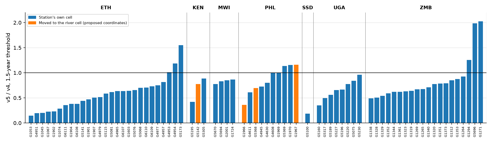
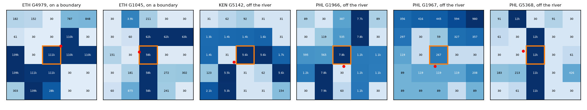

# GloFAS v5 thresholds for NRW, and a station fix found along the way

Preview for AB#45890, 24 November 2026: our own v5 thresholds, computed with ECMWF's method.

**Question:** what do the GloFAS v5 thresholds mean for NRW?

- **Answer:** they are lower, median ×0.67 of v4, so forecasts and thresholds must switch to v5 together.
- Our method reproduces ECMWF's v4 thresholds exactly.

**Found along the way, independent of v5:** 17 station coordinates point at the wrong cell. A small fix, now (AB#45972).

---

<!-- _class: small -->

## The question, and how we can answer it before ECMWF publishes

**Question:** how do NRW's flood thresholds change with GloFAS v5?

**Missing:** ECMWF's v5 threshold files.

**Available:** the [v5 reanalysis](https://ewds.climate.copernicus.eu/datasets/cems-glofas-historical), 1980–2025; the method ([thresholds](https://confluence.ecmwf.int/spaces/CEMS/pages/715612883/GloFAS+flood+threshold+generation), [trend step](https://confluence.ecmwf.int/spaces/CEMS/pages/715612910/Handling+of+non-stationarity+in+the+flood+thresholds)); ECMWF's [code](https://github.com/ec-jrc/lisflood-utilities), to which we added the trend step.

**Per station:**

1. Take the highest discharge of each year.
2. **New in v5:** where yearly peaks clearly rise or fall, shift older years towards the 2025 level.
3. Fit the same curve as for v4 (Gumbel) and read off the thresholds.

**Limits:** a preview, to be replaced by ECMWF's files; reanalysis only.

---

<!-- _class: small -->

## Check: on the v4 reanalysis, we get exactly ECMWF's v4 thresholds

The same calculation without the trend step, on v4 1979–2022. Thresholds in m³/s: **ECMWF / ours / NRW seed data**

| Station   | 1.5 years             | 5 years               | 20 years              |
| --------- | --------------------- | --------------------- | --------------------- |
| MWI G5694 | 1,757 / 1,757 / 1,757 | 2,707 / 2,707 / 2,707 | 3,583 / 3,583 / 3,583 |
| MWI G2001 | 1,779 / 1,779 / 1,779 | 2,886 / 2,886 / 2,886 | 3,907 / 3,907 / 3,907 |
| MWI G1724 | 1,799 / 1,799 / 1,799 | 2,977 / 2,977 / 2,977 | 4,063 / 4,063 / 4,063 |
| MWI G5670 | 276 / 276 / 276       | 826 / 826 / 826       | 1,333 / 1,333 / 1,333 |

Checked for 4 stations only, to save download time.

---

<!-- _class: chart -->

## Answer: v5 thresholds are lower than v4 at most stations

| Country | Stations | Median v5 / v4 | Range         | Lower in v5 |
| ------- | -------- | -------------- | ------------- | ----------- |
| ETH     | 27       | ×0.59          | ×0.14 – ×1.55 | 24          |
| KEN     | 3        | ×0.78          | ×0.42 – ×0.88 | 3           |
| MWI     | 4        | ×0.84          | ×0.77 – ×0.86 | 4           |
| PHL     | 10       | ×0.90          | ×0.36 – ×1.16 | 6           |
| SSD     | 1        | ×0.19          | ×0.19 – ×0.19 | 1           |
| UGA     | 8        | ×0.66          | ×0.35 – ×0.96 | 8           |
| ZMB     | 20       | ×0.69          | ×0.49 – ×2.02 | 17          |

---

## Answer: switch the forecasts and the thresholds to v5 at the same moment

v5 thresholds are generally lower than v4: median ×0.67, because v5 simulates lower river flows.

| Share of years reaching the 1.5-year threshold, 2016–2025 |     |
| --------------------------------------------------------- | --- |
| v4 against v4 thresholds (MWI, 4 stations)                | 75% |
| v5 against v5 thresholds                                  | 74% |
| v5 against today's v4 thresholds                          | 35% |

**So v5 forecasts need v5 thresholds:** with today's thresholds, far fewer alerts.

---

<!-- _class: dense -->

## Next steps for v5

| What                                     | Stations                                                                                                              | Action                                                                   |
| ---------------------------------------- | --------------------------------------------------------------------------------------------------------------------- | ------------------------------------------------------------------------ |
| Switch forecasts and thresholds together | All                                                                                                                   | Migration process (AB#45893)                                             |
| Large drop, below ×0.50                  | G1053, G5100, G4951, G1045, G1067, G1902, G1074, G5160, G6111, G1966, G1904, G6108, G5195, G5141, G1901, G1338, G5317 | Ask the GloFAS team (AB#45889)                                           |
| Large rise, above ×1.50                  | G1271, G5696, G5173                                                                                                   | Same                                                                     |
| Before going live                        | All                                                                                                                   | ECMWF's v5 files; update path for production, tested on test and staging |

---

<!-- _class: dense -->

## Found along the way: some station coordinates point at the wrong cell

v4 upstream area per cell (km²), north up, 0.05° cells. **Red dot:** seed coordinates. **Orange:** proposed river cell.

- **On a cell boundary (13 stations):** the forecast may come from the touching cell that is a much smaller stream.
- **Off the river (4 stations):** forecast and thresholds come from a small cell next to the river.

---

## Independent of v5, but worth fixing now

**Independent of v4 or v5:** the coordinates are wrong today, and in v5 the river is in the same cell as in v4, at all 73 compared stations. So the fix holds after the switch.

**Why now, here:**

- **It affects alerts today:** 13 stations may read their forecast from a much smaller stream; 4 compare a small stream with its own thresholds.
- **It is small:** 17 entries in the seed data, one database migration.
- **The v5 thresholds are then computed at the right cells.**

**Why not more:** a stationless approach may replace stations (spike to come), so only these clear wins; no full review of all stations.

---

<!-- _class: tiny -->

## Proposal: move 17 stations to the centre of their river cell

| Station   | Coordinates now   | Proposed        | Forecast cell now, km² | Proposed, km² | v4 threshold: now → fixed | v5 threshold, fixed |
| --------- | ----------------- | --------------- | ---------------------- | ------------- | ------------------------- | ------------------- |
| KEN G5142 | -1.0950, 37.1940  | -1.075, 37.225  | 31                     | 5,568         | 2 → 194                   | 150                 |
| PHL G1966 | 14.8940, 120.7300 | 14.925, 120.725 | 30                     | 7,806         | 9 → 2,245                 | 810                 |
| PHL G1967 | 15.3440, 120.4650 | 15.375, 120.475 | 119                    | 267           | 41 → 94                   | 108                 |
| PHL G5368 | 8.8860, 125.5410  | 8.875, 125.575  | 30                     | 11,514        | 8 → 2,577                 | 1,794               |
| ETH G1045 | 11.6833, 40.9500  | 11.675, 40.975  | 30 or 58,322           | 58,322        | 1,061, same               | 212                 |
| ETH G1603 | 8.2500, 34.5700   | 8.225, 34.575   | 30 or 23,601           | 23,601        | 1,641, same               | 1,053               |
| ETH G4954 | 11.0500, 41.6500  | 11.075, 41.675  | 30 or 21,064           | 21,064        | 42, same                  | 50                  |
| ETH G4979 | 10.0500, 35.7500  | 10.025, 35.725  | 30 or 110,541          | 110,541       | 8,474, same               | 4,376               |
| ETH G5068 | 8.7000, 38.6000   | 8.675, 38.625   | 30 or 4,411            | 4,411         | 279, same                 | 195                 |
| ETH G5141 | 4.3500, 41.9500   | 4.325, 41.975   | 31 or 56,670           | 56,670        | 1,286, same               | 566                 |
| ETH G5173 | 2.8500, 37.4500   | 2.825, 37.475   | 31 or 31,687           | 31,687        | 4, same                   | 6                   |
| ETH G6108 | 8.2500, 37.7666   | 8.225, 37.775   | 30 or 1,919            | 1,919         | 1,053, same               | 402                 |
| KEN G5305 | -1.5000, 40.0500  | -1.525, 40.075  | 62 or 54,125           | 54,125        | 512, same                 | 452                 |
| ZMB G1312 | -13.2500, 28.1333 | -13.275, 28.125 | 60 or 16,490           | 16,490        | 402, same                 | 341                 |
| ZMB G1323 | -13.7000, 26.3333 | -13.725, 26.325 | 180 or 19,697          | 19,697        | 361, same                 | 228                 |
| ZMB G1361 | -16.1167, 23.2500 | -16.125, 23.275 | 652 or 288,813         | 288,813       | 2,761, same               | 1,720               |
| ZMB G5696 | -16.3500, 23.4500 | -16.375, 23.425 | 30 or 1,627            | 1,627         | 23, same                  | 47                  |

Upstream area of the cell the forecast comes from: on a boundary, either touching cell. 1.5-year threshold in m³/s.

- **Off the river:** GloFAS's own river cell, checked in the GloFAS viewer. **On a boundary:** the river cell of today's thresholds.
- **How:** seed-data PR, and a database migration for test, staging and production (AB#45972).

---

<!-- _class: dense -->

## Backup: the new model causes most of the change, not the trend step

- **Model:** v5 without trend step / v4, median ×0.67.
- **Trend step:** v5 / v5 without trend step, median ×1.00; more than 10% change at 12 of 73 stations. It is the one step we could not check against ECMWF.

Where the trend step matters most, 1.5-year threshold in m³/s:

| Station   | v4    | v5 without trend step | v5    | Trend per decade |
| --------- | ----- | --------------------- | ----- | ---------------- |
| SSD G5100 | 5,991 | 2,247                 | 1,124 | -26%             |
| ETH G4954 | 42    | 81                    | 50    | -32%             |
| UGA G5160 | 64    | 33                    | 23    | -19%             |
| UGA G5189 | 29    | 22                    | 16    | -18%             |
| UGA G5227 | 24    | 19                    | 16    | -15%             |
| ETH G6110 | 109   | 66                    | 77    | +11%             |
