# From hand-made lists to one basin per GloFAS station

What the first rule does, what we can vary, and where the analysis points

Spike AB#42674 · work in progress · station locations of NRW-seed-data `3639e28`, before the move of 17 stations

---

<!-- _class: divider -->

# 1. Initial plan

Why we want basins, and the rule we started with

---

## Today each station is tied to a hand-made list of admin areas

- There are 73 GloFAS stations in seven countries: ETH 27, ZMB 20, PHL 10, UGA 8, MWI 4, KEN 3, SSD 1.
- When a station passes its threshold, the admin areas on its list get the alert.
- The lists are made by hand, and it shows:
  - 18 stations have a footprint in two separate parts, up to 219 km apart;
  - 28 stations lie outside their own footprint;
  - 2 stations have no admin areas at all (PHL G4608, ZMB G1338).
- The plan is to replace each list with a river basin from HydroBASINS, chosen by a rule.

---

## The initial rule (draft PR #99)

> Each station gets the largest HydroBASINS basin (levels 4 to 12) that contains it and no other station, with an area of at most 50,000 km².

- Other stations are counted per country.
- Proposed addition: drop a station whose basin is smaller than 100 km².
- We ran the rule on all 73 stations and compared the result with today's footprints and with the 10-year flood map.

---

<!-- _class: divider -->

# 2. Initial results

A few examples that show why the rule needs refinement

---

## Every station gets a basin, but only a third of today's flooded area stays covered

| Country       | Stations | Land covered today | Land covered by the rule | Flooded area covered today that stays covered |
| ------------- | -------- | ------------------ | ------------------------ | --------------------------------------------- |
| Ethiopia      | 27       | 14%                | 31%                      | 61%                                           |
| Kenya         | 3        | 4%                 | 10%                      | 26%                                           |
| Malawi        | 4        | 2%                 | 20%                      | 46%                                           |
| Philippines   | 10       | 14%                | 25%                      | 65%                                           |
| South Sudan   | 1        | 5%                 | 2%                       | 5%                                            |
| Uganda        | 8        | 23%                | 25%                      | 32%                                           |
| Zambia        | 20       | 60%                | 25%                      | 36%                                           |
| **All seven** | **73**   | **20%**            | **21%**                  | **35%**                                       |

"Flooded area" is the 10-year flood map. Today's footprints are the reference we have, not the truth.

---

<!-- _class: figure -->

## Where it works: the basin joins a footprint that admin borders split in two

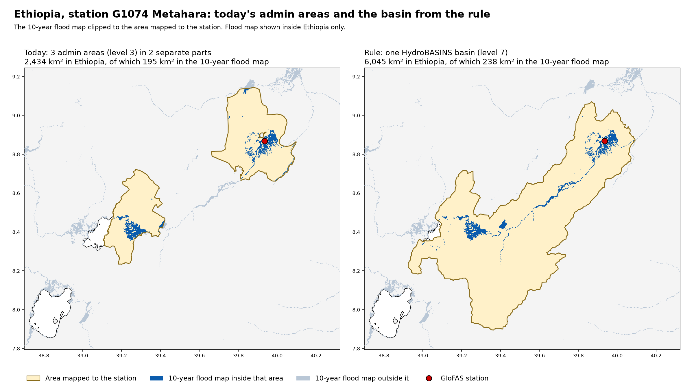

Metahara (ETH G1074): today's footprint is two parts 35 km apart. 94% of its flooded area lies inside the basin.

---

<!-- _class: figure -->

## Where it fails: the basin lies upstream of the station and the floodplain drops out

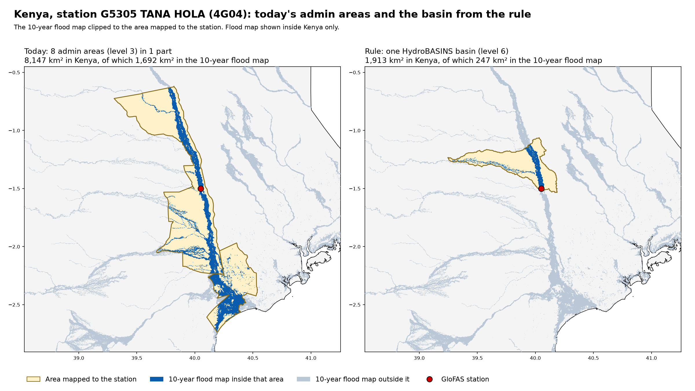

Tana Hola (KEN G5305): the flooded area tied to the station falls from 1,692 to 247 km². 28 of 73 stations sit at the downstream end of their basin.

---

<!-- _class: figure -->

## Where old and new disagree completely: no overlap at all

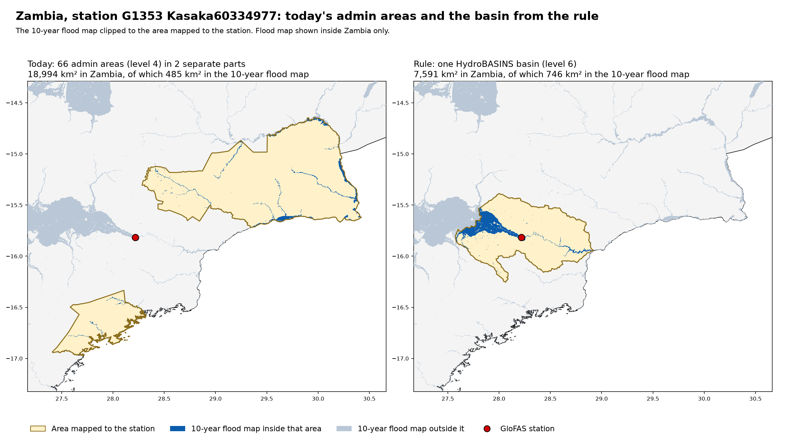

Kasaka (ZMB G1353): the footprint is two parts 95 km apart. 8 stations have no overlap; 23 of 71 keep under 10% of their footprint.

---

<!-- _class: figure -->

## Kenya has three stations and three different problems

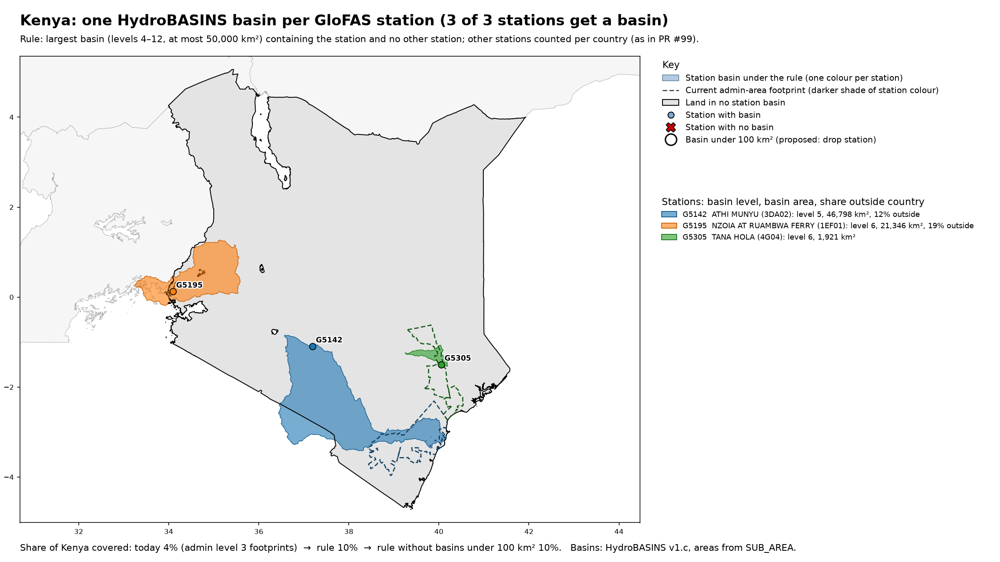

G5142: a headwater station gets 46,798 km². G5305: 1,921 km² upstream of the station. G5195: shares its basin with a Ugandan station.

---

## What goes wrong, in four groups

| Problem                                              | How often                                                                               | Example                                              |
| ---------------------------------------------------- | --------------------------------------------------------------------------------------- | ---------------------------------------------------- |
| The basin lies upstream of the station               | 28 of 73 stations sit at the downstream end of their basin                              | KEN G5305, SSD G5100                                 |
| The basin's size depends on where other stations are | 31 of 73 stations                                                                       | MWI G1724: 22 km² on a river that drains 146,866 km² |
| Small rivers get very large basins                   | 18 basins over 20,000 km²; 9 stations sit in a side polygon of a large river            | UGA G5160: 39,281 km²                                |
| Special cases                                        | 1 lumped coastal unit, 2 stations outside their country, 1 basin shared across a border | PHL G4611, ETH G5173, KEN G5195 with UGA G5230       |

The rule needs refinement before the hydrologists can sign off on it.

---

<!-- _class: divider -->

# 3. What can we vary?

The choices a rule makes, and how we compare variants

---

<!-- _class: dense -->

## A rule makes ten choices; seven are tested here

| Group          | Choice                                  | In the PR rule             | Varied over                  | Tested |
| -------------- | --------------------------------------- | -------------------------- | ---------------------------- | ------ |
| Which polygons | Start level: the coarsest level allowed | 4                          | 4 to 9                       | yes    |
|                | Area cap                                | 50,000 km²                 | 5,000 km² to none            | yes    |
|                | Minimum area                            | none (100 km² proposed)    | 0 to 2,500 km²               | yes    |
|                | Lumped coastal units                    | allowed                    | excluded                     | yes    |
| Other stations | Must the station be alone in its basin? | yes                        | stations may share a basin   | yes    |
|                | Which other stations count              | own country                | all seven countries          | yes    |
| Direction      | Reach along the river                   | the station's polygon only | plus 50 to 500 km downstream | yes    |
| Not tested yet | Station placement                       | raw coordinates            | match on upstream area       | no     |
|                | Borders                                 | basins are not clipped     | clip, or stop at the border  | no     |
|                | Manual corrections                      | none                       | an override list per station | no     |

---

## Every variant is measured on the same numbers

- **Unit size:** the median and the largest area mapped to a station.
- **Usable units:** stations with no unit, or with one under 100 km².
- **Stability:** stations whose unit changes when other stations are added or removed.
- **Agreement with today:** the share of the flooded area covered today that stays covered.
- **Flood coverage:** the share of the whole 10-year flood map that lies inside a unit.
- **Land:** the share of the countries' land mapped to a station.

One choice is varied at a time; the others stay as in the PR rule.

Today's footprints cover 20% of the land and 26% of the flood map. They are the reference, not the truth.

---

<!-- _class: divider -->

# 4. Structured analysis

One choice at a time

---

<!-- _class: figure -->

## Start level: 6 changes little; 7 removes the large basins but halves the agreement

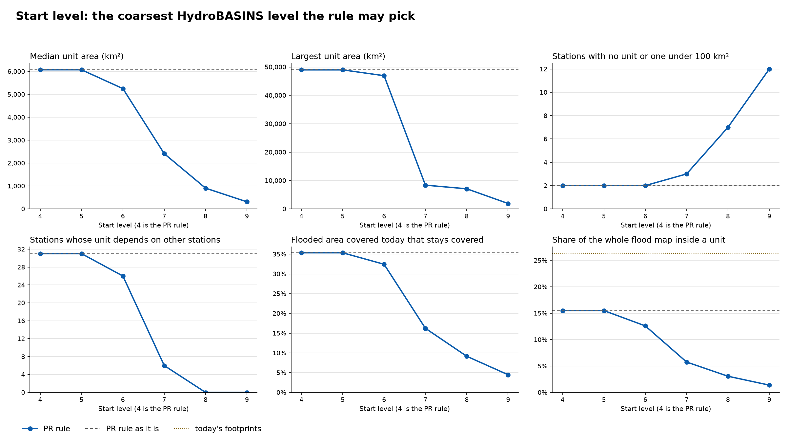

From level 6, 12 basins are still over 20,000 km². From level 7 there are none, but the flooded area that stays covered falls from 35% to 16%.

---

<!-- _class: figure -->

## Area cap: the strongest lever inside the PR rule, and it trades against stability

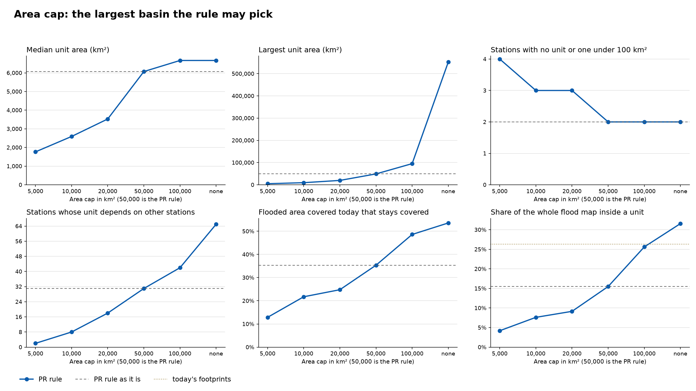

Without a cap 54% stays covered, but 65 of 73 stations depend on other stations and the largest basin is 552,625 km². At 5,000 km²: 2 stations and 13%.

---

<!-- _class: figure -->

## Minimum area: it removes stations, not a problem

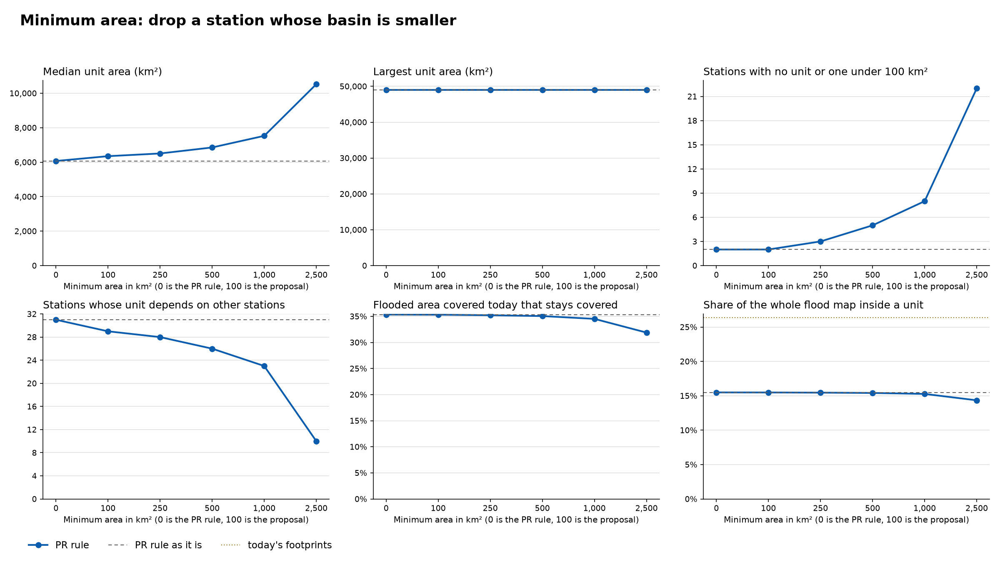

100 km² drops 2 stations and 1,000 km² drops 8. They sit on large rivers; their basins are small because of a neighbouring station. Coverage barely moves.

---

## Station scope and coastal units: each changes one or two stations

| Choice                                    | Stations that change       | What changes                                                                   |
| ----------------------------------------- | -------------------------- | ------------------------------------------------------------------------------ |
| Count the stations of all seven countries | 2: KEN G5195 and UGA G5230 | They no longer share one 21,346 km² basin; they get 1,307 and 2,104 km²        |
| Exclude lumped coastal units              | 1: PHL G4611               | A 21,020 km² strip of unconnected coastal catchments becomes a 2,905 km² basin |

- Neither moves the totals: the flooded area that stays covered goes from 35.3% to 35.2% and 34.9%.
- Both are cheap to adopt.

---

<!-- _class: figure -->

## Uniqueness: from level 7 on, requiring a station to be alone changes almost nothing

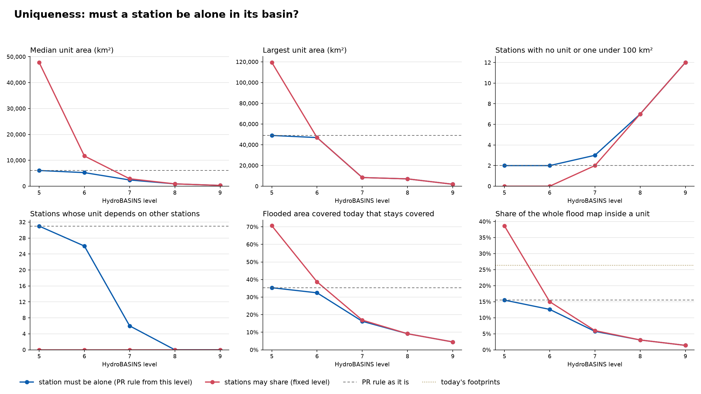

At level 7, shared basins give nearly the same sizes and coverage, and no station depends on another (6 before). At level 5 shared basins have a median of 47,770 km².

---

<!-- _class: figure -->

## Direction: following the river downstream brings the floodplain back

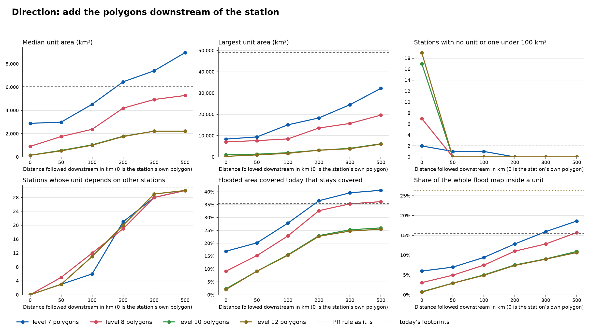

Level-7 polygons: 17% stays covered with the station's own polygon, 37% with 200 km downstream. From 200 km on, no unit is under 100 km².

---

<!-- _class: figure -->

## All variants together: downstream variants keep more flooded area per km² of land

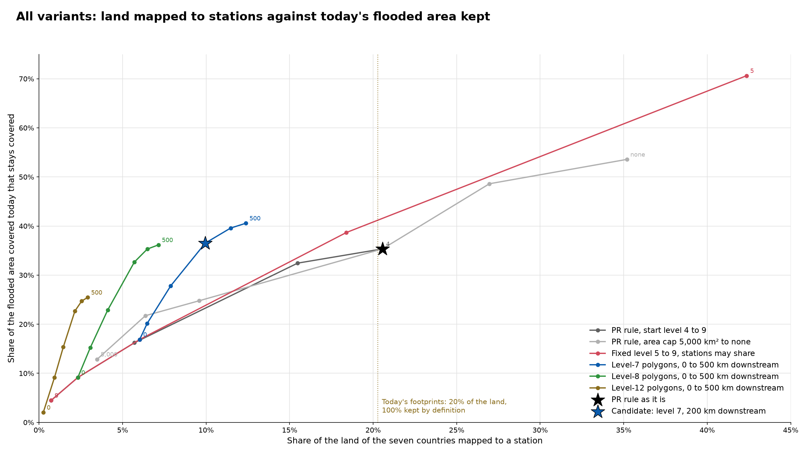

The candidate (level 7, 200 km downstream) keeps as much as the PR rule, 37% against 35%, with half the land: 10% against 21%.

---

## Not tested yet

- **Station placement:** 9 stations sit in a small side polygon next to a large river. NRW-seed-data PR #24 moves 17 stations to their river cell; this analysis uses the locations before that move.
- **Borders:** 12 candidate units lie more than half outside their country outline (lake surface counts as outside). Clip them, or stop at the border?
- **Upstream reach:** for PHL G4630 today's footprint lies upstream of the station, not downstream.
- **Flood-map-based units:** keep only the flooded part of each unit.
- **Trace settings per country:** the polygon level and the distance, and other return periods of the flood map.
- **Manual corrections** on top of the rule.

---

<!-- _class: divider -->

# 5. Preliminary conclusions

What the analysis says so far

---

## Preliminary conclusions

1. The PR rule's own settings trade basin size against coverage. None of them fixes the direction problem.
2. A start level of 6 does little. A start level of 7 halves the agreement with today.
3. "Alone in its basin" causes the dependence on other stations and the tiny basins. From level 7 on it can be dropped at no cost.
4. Following the river downstream matters most: as much flooded area stays covered as under the PR rule, with half the land and no unit under 100 km².
5. The minimum-area rule is then not needed. Counting all countries and excluding coastal units are cheap fixes for the PR rule; the candidate needs neither.
6. No variant with units under 20,000 km² keeps more than 37% of the flooded area covered today. Basins and today's footprints answer different questions.

---

## A candidate for the next round, and what we need from the hydrologists

> The station's level-7 polygon plus the polygons up to 200 km downstream, stopping at the next station. Stations in the same polygon share a unit.

- It is not better for every station: 18 keep more of their flooded area than under the PR rule, 17 keep less, 35 about the same.
- Its units cross borders: 12 lie more than half outside their country outline (lake surface counts as outside).

Questions for the hydrologists:

1. Is today's footprint the right reference, or is it too wide? In Zambia it covers 60% of the land.
2. How far downstream does a station say something: a fixed distance, or up to the next station or confluence?
3. Should a station also cover its upstream reach?
4. Which stations need a manual correction whatever the rule?

---

<!-- _class: divider -->

# 6. Country deep-dives

Today's footprints, the PR rule and the candidate, side by side

---

<!-- _class: figure -->

## Ethiopia: the candidate uses 12% of the land instead of 31%, and keeps 45% instead of 61%

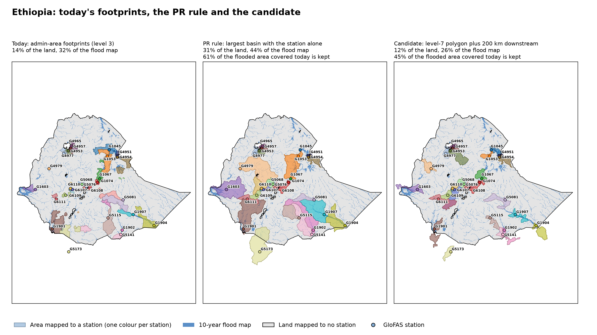

Gains on the Awash (G1045: 4% to 66%, G1067: 1% to 69%). Losses where the PR rule gave a whole basin (G1907: 100% to 10%). G5173 lies in Kenya.

---

<!-- _class: figure -->

## Kenya: the candidate doubles the flooded area that stays covered, with half the land

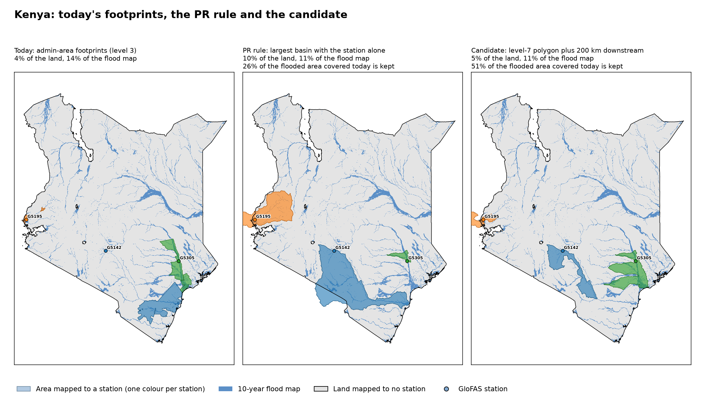

G5305 (Tana): 12% to 69%. G5142 (Athi): 50% to 0%; its footprint starts 312 km downstream. G5195: 68% of its unit is outside Kenya.

---

<!-- _class: figure -->

## Malawi: the candidate keeps 95% of the flooded area covered today

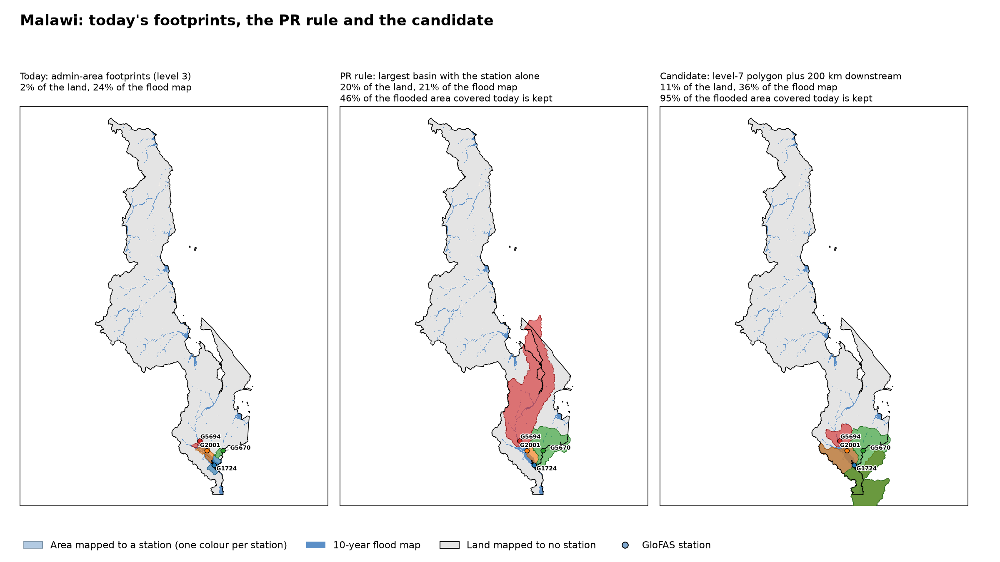

G1724 and G2001 share one unit down the Shire: 7% to 79% and 33% to 93%. Three of the four units lie more than half outside Malawi.

---

<!-- _class: figure -->

## Philippines: rivers are short, so downstream adds little; the coastal strip disappears

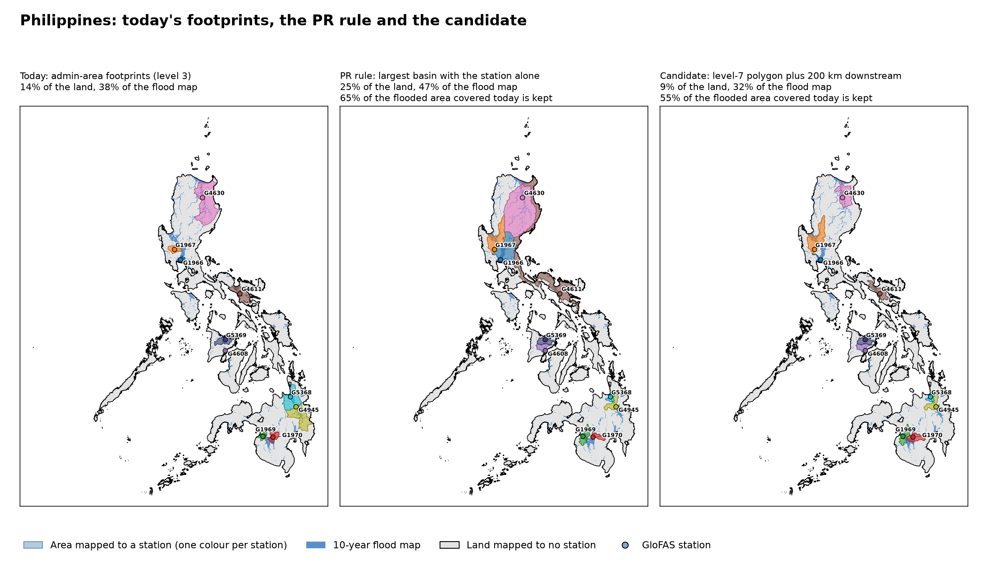

G4611: 21,020 km² becomes 2,905 km². G1970: 14% to 86%. G4630 (Cagayan): 82% to 47%, because today's footprint lies largely upstream of the station.

---

<!-- _class: figure -->

## South Sudan: one station cannot cover the Sudd under any rule

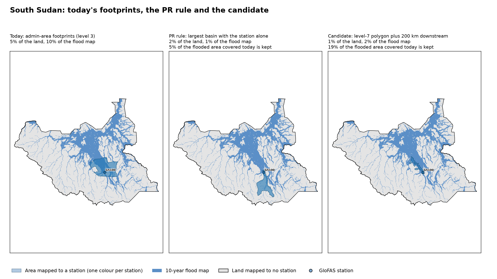

Today's footprint holds 12,147 km² of flood map. The PR rule keeps 5% of it and the candidate 19%. This needs a manual area or more stations.

---

<!-- _class: figure -->

## Uganda: the candidate keeps 46% instead of 32%, with a third less land

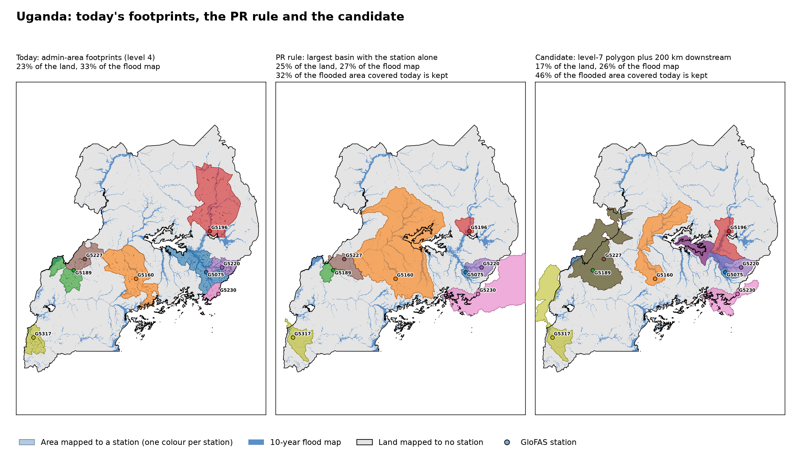

G5075: 5% to 49%. G5189: 3% to 38%. G5160 (Mayanja): 66% to 38%, as it no longer gets a 39,281 km² unit. G5230 lies outside Uganda.

---

<!-- _class: figure -->

## Zambia: today's footprints cover 60% of the land; both rules keep about a third

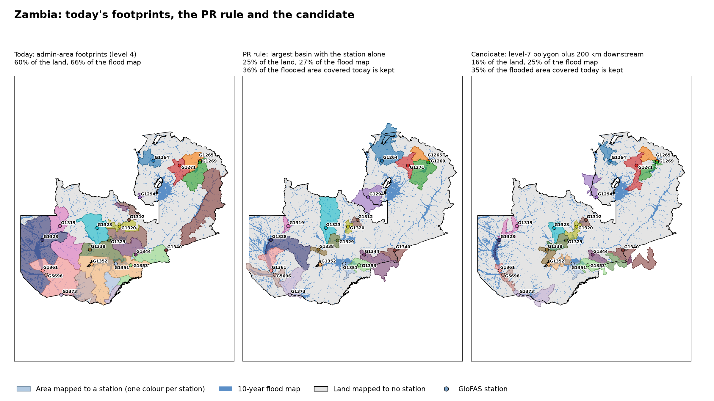

G1352: 2% to 37%. Five stations keep nothing under either rule (G1312, G1340, G1344, G1373, G5696): their footprints are somewhere else entirely.

---

## Next steps

1. Put the four questions to the hydrologists, with the country figures.
2. Test the two open choices that the candidate exposes: station placement and borders.
3. Tune the trace per country: polygon level, distance, and whether to add the upstream reach.
4. Draw up the list of stations that need a manual correction.

---

<!-- _class: dense -->

## Appendix: sources and method

- **Stations and admin areas:** NRW-seed-data at commit `3639e28`. Flood admin level 4 for Uganda and Zambia, 3 elsewhere.
- **Basins:** HydroBASINS v1.c, standard variant, levels 4 to 12. Africa file, and the Australasia file for the Philippines. Areas are `SUB_AREA`.
- **Flood map:** the 10-year extent from the seed repo (`data-png`), flooded where the depth is above zero, counted inside each country only.
- **Shares of land and flooded area** are counted on the 90 m grid of the flood map.
- **Stability** compares each station's unit with the unit the same rule gives that station on its own.
- **Downstream trace:** follows `NEXT_DOWN` from the station's polygon and stops at the distance limit, at a polygon that holds another station, at the river's end, or at the edge of the loaded data (a box around each country).
- **Not verified:** the variants other than the PR rule have been checked on totals and on the country figures, not station by station.
- Scripts are in `data/analysis/station_basins/`: `initial_rule.py` and `rule_sensitivity.py`. The tables are next to this deck, for example `sensitivity/per_rule.csv`.
